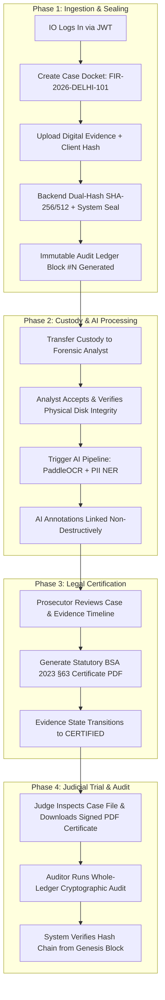
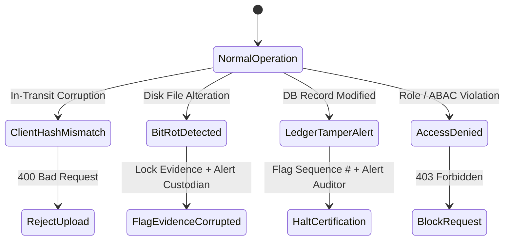

# SIH26190 E-Vault — User Perspective Application Flow & Operations Manual

This document provides a comprehensive, step-by-step walkthrough of how the **Secure Digital Evidence and Legal Document Management System (E-Vault)** functions from the perspective of various law enforcement, forensic, legal, judicial, and audit stakeholders.

---

## 1. System Stakeholders & Role Matrix

The E-Vault enforces strict need-to-know access control across 7 operational roles:

| Role Name | Persona / Description | Core Responsibilities & Permitted Actions |
|---|---|---|
| **`INVESTIGATING_OFFICER`** | Police Inspector / Investigating Officer (IO) | Creates cases, ingests physical/digital evidence, transfers custody, uploads legal documents (FIR, Seizure Memo). |
| **`FORENSIC_ANALYST`** | Cyber Cell / FSL Forensic Expert | Receives evidence, runs physical integrity verifications, executes AI OCR/NER analysis, annotates forensic findings. |
| **`PROSECUTOR`** | Public Prosecutor / Legal Counsel | Reviews case dockets, inspects evidence timelines, generates statutory BSA 2023 §63 court certificates. |
| **`COURT`** | Judge / Court Registrar | Read-only judicial inspection of dockets, trial bundles, chain-of-custody timelines, and statutory §63 PDF certificates. |
| **`AUDITOR`** | Independent Vigilance / Audit Officer | Conducts system-wide cryptographic audits, recomputes hash-chained audit ledgers (`GET /ledger/verify`), inspects tamper logs. |
| **`RECORDS_CUSTODIAN`** | Vault / Evidence Room Manager | Manages physical vault location metadata and digital retention/archival lifecycles. |
| **`SYSTEM_ADMIN`** | IT Administrator | Manages user onboarding, tenant configuration, cryptographic key rotation, and system health. |

---

## 2. High-Level End-to-End User Flow

---

## 3. Phase-by-Phase Operational Workflow

### Phase 1: Case Docket Initialization & Evidence Acquisition

#### Step 1.1: Officer Authentication & Onboarding
- **User Action**: Investigating Officer (IO) Vikram Rathore logs into the system with credentials (`officer_vikram`).
- **System Action**: 
  1. Authenticates BCrypt password hash in PostgreSQL.
  2. Issues an HMAC-SHA256 JWT Bearer Token containing `userId`, `role=INVESTIGATING_OFFICER`, and `department=Cyber Crime Cell`.
  3. Populates `ActorContextHolder` for thread-safe session tracking.

#### Step 1.2: FIR Case Docket Creation
- **User Action**: Officer Rathore creates a new investigation case by filling in docket parameters:
  - **FIR Number**: `FIR-2026-DELHI-101`
  - **Title**: *Operation Cyber Vault*
  - **Jurisdiction**: *Delhi Cyber Crime PS*
  - **Acts / Sections**: *IT Act §66C, IPC §420*
- **System Action**:
  - Validates FIR number uniqueness.
  - Initializes `Case` entity in state `OPEN`.
  - Binds Officer Rathore as the `leadInvestigatingOfficerId`.
  - Writes transaction entry to `audit_ledger`: `ACTION = CASE_CREATED`.

#### Step 1.3: Digital Evidence Ingestion & Cryptographic Sealing
- **User Action**: Officer Rathore uploads seized digital evidence (e.g., `seized_phone_dump.bin`, 4.2 GB) collected during a search operation.
- **System Action**:
  1. Streams raw binary data while simultaneously calculating **SHA-256** and **SHA-512** cryptographic checksums.
  2. Validates server SHA-256 against `clientSha256` (provided by field acquisition tool) to prevent in-transit corruption.
  3. Computes digital HMAC signature over raw binary + ingestion metadata.
  4. Stores file securely under partitioned storage: `./data/uploads/cases/{caseId}/evidence/{evidenceId}/`.
  5. Initializes `EvidenceItem` with `custodyState = INGESTED`.
  6. Automatically appends block to `audit_ledger`:
     $$\text{entryHash}_n = \text{SHA-256}(\text{seq}_n \parallel \text{timestamp} \parallel \text{actorId} \parallel \text{INGEST} \parallel \text{evidenceId} \parallel \text{prevHash})$$

---

### Phase 2: Chain of Custody Handoff & Forensic AI Processing

#### Step 2.1: Custody Handoff to Forensic Laboratory
- **User Action**: Officer Rathore transfers custody of `seized_phone_dump.bin` to Forensic Analyst Dr. Meera Nair (`analyst_meera`).
- **Input Form**:
  - **Target Custodian**: `Dr. Meera Nair (FSL-9021)`
  - **Statutory Justification**: *"Transferred for mobile forensic extraction, WhatsApp chat recovery, and financial PII identification."*
- **System Action**:
  - Verifies Officer Rathore currently holds custody.
  - Creates a `CustodyEvent` record of type `TRANSFER`.
  - Appends `CUSTODY_TRANSFERRED` transaction block into the hash-chained `audit_ledger`.

#### Step 2.2: Physical Disk Integrity Verification
- **User Action**: Analyst Dr. Meera receives notification, opens the evidence dashboard, and clicks **"Verify Physical Integrity"**.
- **System Action (`POST /api/v1/evidence/{id}/verify-integrity`)**:
  1. Opens stored raw binary from disk storage.
  2. Re-computes SHA-256 checksum on the fly.
  3. Compares generated checksum against the original ingestion snapshot.
  4. Returns **`VERIFIED`** status if matched, or flags **`TAMPER_ALERT`** if disk bit-rot or file alteration occurred.

#### Step 2.3: Automated AI OCR & PII Annotation Pipeline
- **User Action**: Analyst Dr. Meera clicks **"Trigger AI Analysis"** for scanned documents/images extracted from the phone dump.
- **System Action (`POST /api/v1/evidence/{id}/analyze`)**:
  1. Backend `AiGatewayClient` sends image binary to the Python FastAPI microservice (`http://localhost:8000/api/v1/process-document`).
  2. **PaddleOCR v3.7+** extracts text lines and bounding box coordinates.
  3. **NER Engine** scans text for Indian regulatory PII entities:
     - **Aadhaar Numbers** (e.g., `XXXX-XXXX-1234`)
     - **PAN Cards** (e.g., `ABCDE1234F`)
     - **Phone Numbers & Email Addresses**
  4. Python microservice returns JSON annotation payload.
  5. Backend creates `AiAnalysis` entity linked to `EvidenceItem`.
  6. **Immutability Guarantee**: The original evidence binary remains 100% untouched; AI annotations reside strictly in derived database entities.

---

### Phase 3: Statutory Evidence Certification under BSA 2023 §63

#### Step 3.1: Trial Bundle & Legal Document Assembly
- **User Action**: Public Prosecutor Sharma reviews the case workspace, examining linked FIRs, Seizure Memos, Forensic AI Reports, and the complete chain of custody timeline.
- **System Action**: Displays all versioned legal documents (`v1`, `v2`) with SHA-256 hashes per revision.

#### Step 3.2: Statutory BSA §63 Certificate Generation
- **User Action**: Prosecutor Sharma clicks **"Issue Section 63 Certificate"**.
- **System Action (`POST /api/v1/certificates/evidence/{evidenceId}`)**:
  1. Collects case metadata, hardware particulars, acquisition timestamps, cryptographic hash snapshots (SHA-256 & SHA-512), and complete custody timeline.
  2. Uses **OpenPDF** engine to auto-generate a statutory PDF certificate matching the official Schedule under Section 63 of Bharatiya Sakshya Adhiniyam, 2023:
     - **Header**: Ministry of Home Affairs / State Police Emblem & Certificate ID (`CERT-BSA63-2026-XXXX`).
     - **Part A (Device & Software Particulars)**: Device make/model, serial number, seizure date, extraction tool versions.
     - **Part B (Cryptographic Hash Snapshot)**: Monospace SHA-256/512 checksums and HMAC digital seal.
     - **Custody Timeline Table**: Complete chronological event log.
     - **Statutory Legal Declaration §63(4)**: Mandatory legal assertion of system integrity and lawful custody.
  3. Saves signed PDF to storage and updates evidence `custodyState` to `CERTIFIED`.
  4. Logs `CERTIFICATE_ISSUED` into `audit_ledger`.

---

### Phase 4: Judicial Review & Independent Cryptographic Audit

#### Step 4.1: Judicial Docket Inspection
- **User Action**: Honorable Judge / Court Registrar logs into the Court Portal with `COURT` role.
- **System Action**:
  - Renders read-only judicial view of docket `FIR-2026-DELHI-101`.
  - Hides mutation buttons (upload, edit, delete).
  - Provides one-click access to preview and download the signed **BSA §63 PDF Certificate**.

#### Step 4.2: Independent System-Wide Cryptographic Audit
- **User Action**: Independent Auditor logs into the Vigilance Portal and triggers **"Verify Whole Ledger Integrity"**.
- **System Action (`GET /api/v1/ledger/verify`)**:
  1. Fetches all transaction blocks in `audit_ledger` from sequence `1` (Genesis Block) to sequence `N`.
  2. Iteratively recomputes:
     $$\text{expectedHash}_i = \text{SHA-256}(\text{seq}_i \parallel \text{occurredAt}_i \parallel \text{actorId}_i \parallel \text{action}_i \parallel \text{resourceRef}_i \parallel \text{details}_i \parallel \text{entryHash}_{i-1})$$
  3. Compares `expectedHash_i` against `entryHash_i` stored in database.
  4. If database administrator modified historical SQL records directly, verification fails and pinpoints exact `brokenSeq`.
  5. If intact, returns **`LEDGER_INTEGRITY_VERIFIED`** with 0 broken links.

---

## 4. User Perspective Exception & Error Handling

1. **In-Transit Transmission Corruption**:
   - *Symptom*: User attempts to upload a file over an unstable network.
   - *Behavior*: Server SHA-256 computation does not match `clientSha256`. System rejects upload immediately with `400 Bad Request: Client hash mismatch`. No corrupted records are created.
2. **Physical Disk Tampering / Bit-Rot**:
   - *Symptom*: File bytes on physical disk are altered or corrupted by hardware failure.
   - *Behavior*: Running `/verify-integrity` recalculates SHA-256 from disk and detects discrepancy against the ingestion snapshot. Status transitions to `CORRUPTED`, generating an emergency alert in the Audit Ledger.
3. **Database Ledger Tampering**:
   - *Symptom*: A rogue DB admin executes `UPDATE audit_ledger SET actor_id = ...` directly in PostgreSQL.
   - *Behavior*: Recomputing the ledger (`GET /ledger/verify`) detects that `entryHash_k` does not equal `SHA-256(...)` for block $k$. The system highlights sequence $k$ as compromised and blocks court certificate issuance.
4. **Unauthorized Access Violation**:
   - *Symptom*: An unassigned officer attempts to alter case status or download restricted evidence.
   - *Behavior*: `CaseSecurityService` denies access, returning `403 Forbidden`. The unauthorized attempt is permanently logged into the audit ledger for security compliance.
