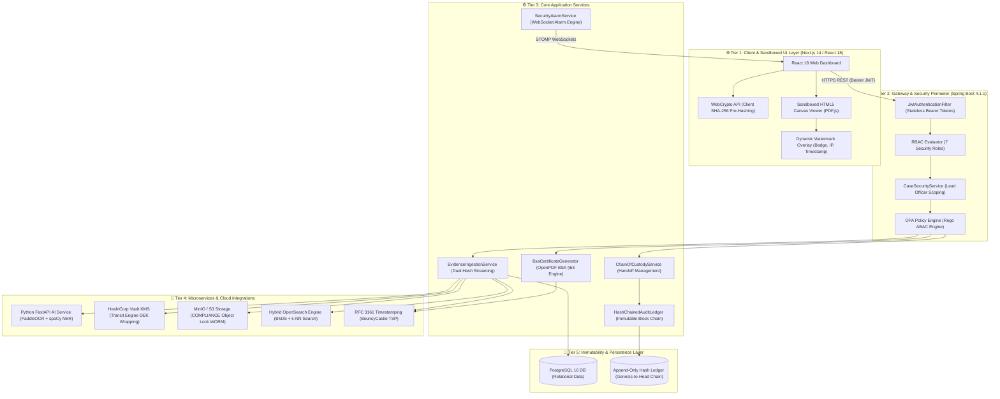
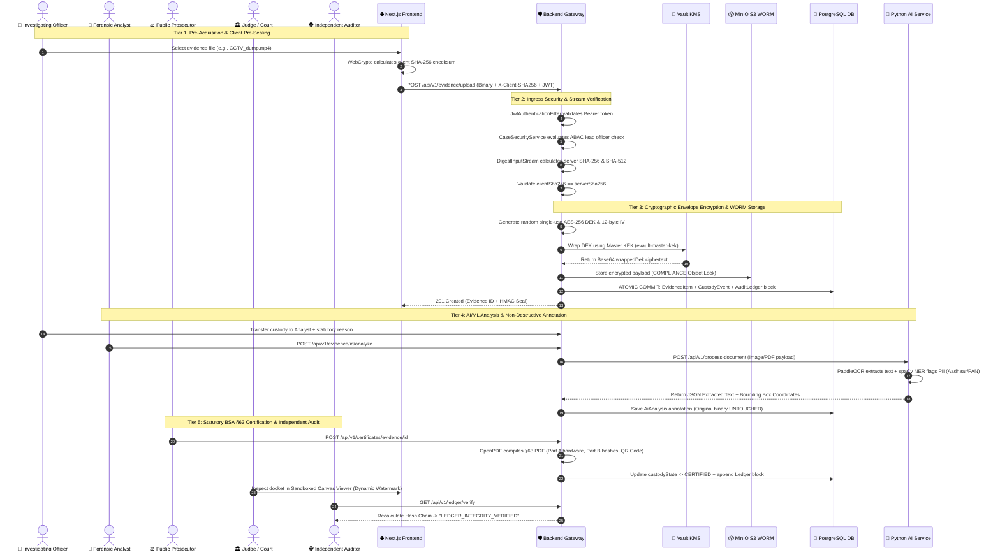
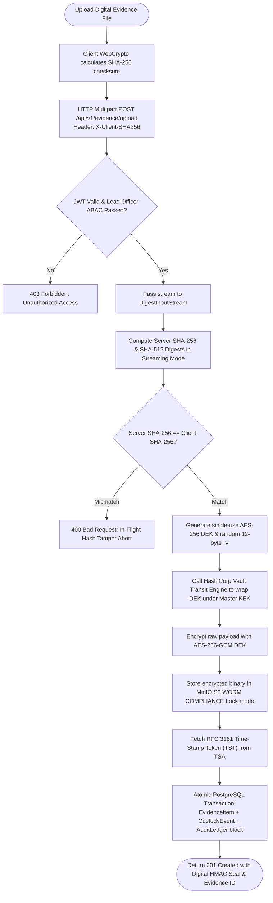
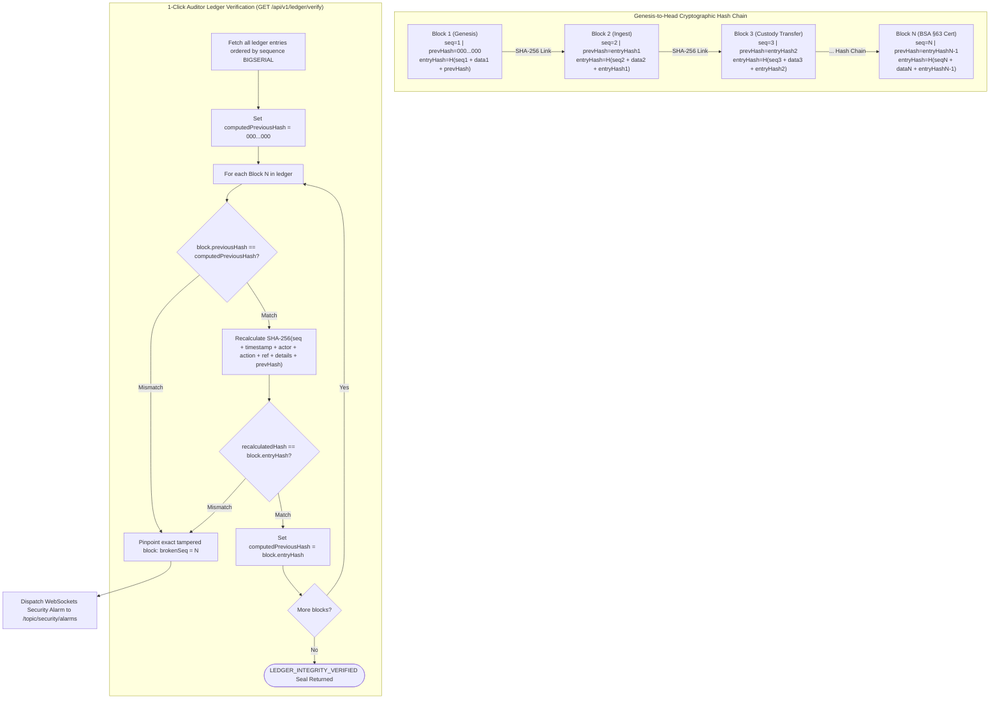
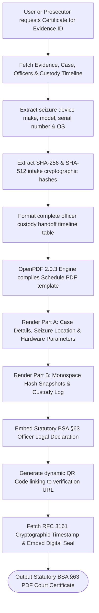
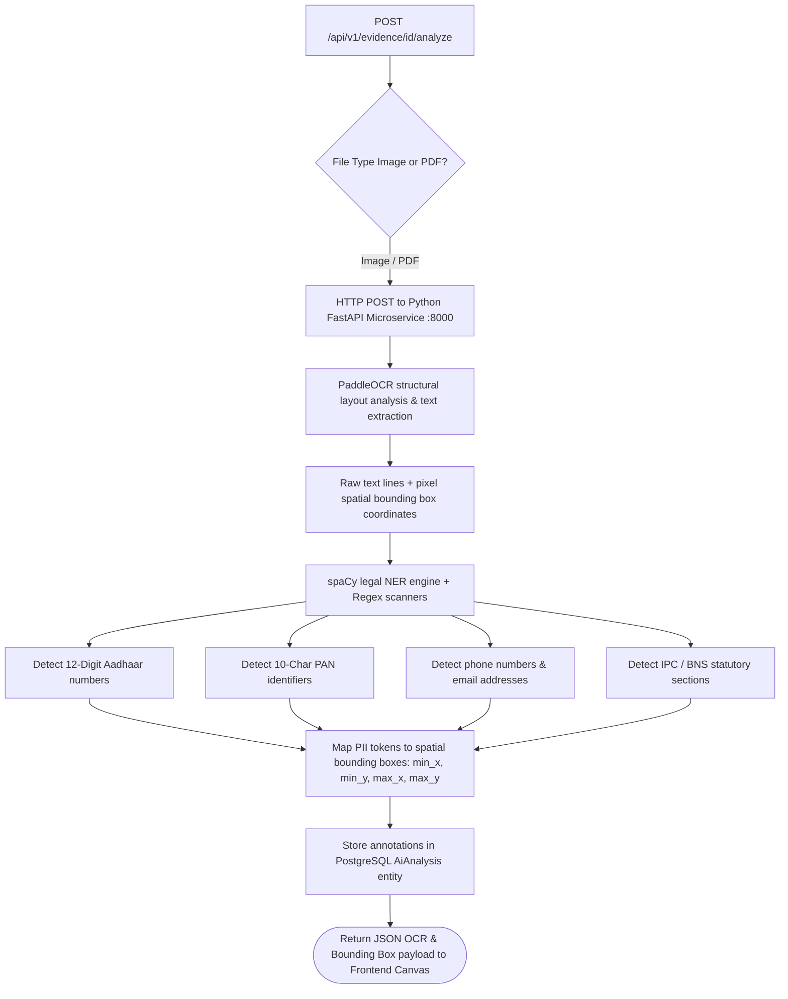
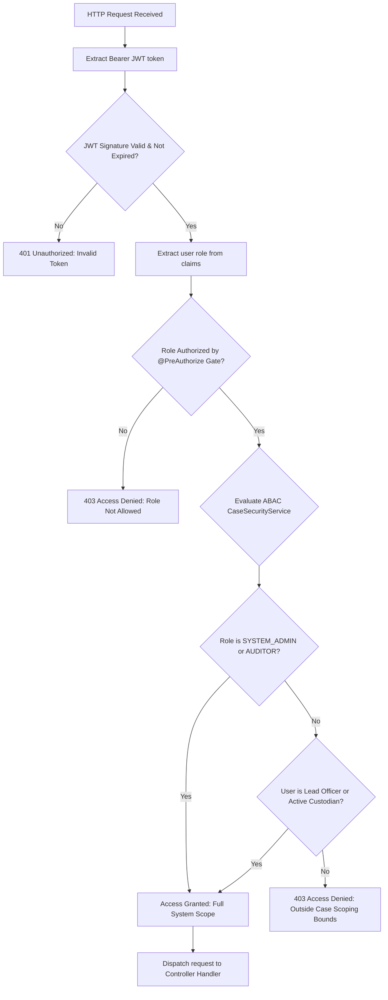

# Secure Digital Evidence & Legal Document Management System (E-Vault)
### Smart India Hackathon (SIH26190) — Nodal Ministry: Ministry of Home Affairs (MHA)

[](https://adoptium.net/)
[](https://spring.io/projects/spring-boot)
[](https://nextjs.org/)
[](https://spring.io/projects/spring-security)
[](https://www.python.org/)
[](https://fastapi.tiangolo.com/)
[](https://github.com/PaddlePaddle/PaddleOCR)
[](https://www.postgresql.org/)
[](https://www.vaultproject.io/)
[](https://min.io/)
[](https://opensearch.org/)
[](https://github.com/LibrePDF/OpenPDF)
[-success.svg?style=flat-square)]()
[]()

---

## 1. Executive Summary & System Vision

The **Secure Digital Evidence and Legal Document Management System (E-Vault)** is an enterprise-grade, zero-trust platform engineered to secure the acquisition, storage, analysis, chain of custody, and legal certification of digital evidence and case files for Indian law enforcement agencies, forensic laboratories, prosecutors, and judicial courts.

> [!IMPORTANT]
> Developed for **Problem Statement ID SIH26190** under the guidance of the **Ministry of Home Affairs (MHA)**, the E-Vault bridges the gap between field investigation digital capture and court admissibility under the **Bharatiya Sakshya Adhiniyam, 2023 (BSA)**.

### 1.1 The Systemic Problem (Problem Statement ID: SIH26190)
The Indian criminal justice lifecycle relies heavily on sensitive documentation—including First Information Reports (FIRs), Case Diaries, Seizure Memos, Charge Sheets, CCTV footage, phone extractions, and Forensic Laboratory (FSL) Reports. Currently, digitized legal records face three systemic vulnerabilities:

1. **Evidentiary Compromise**: Electronic evidence submitted in court is frequently rejected under **Section 63 of the Bharatiya Sakshya Adhiniyam, 2023 (BSA)** if the prosecution cannot prove an unbroken, tamper-evident chain of custody from the exact second of seizure.
2. **Insider Threat & Retroactive Tampering**: Database administrators or malicious insiders can silently alter, swap, or backdate evidence files in standard SQL databases without leaving an unalterable audit trail.
3. **Information Leaks & Data Exfiltration**: Uncontrolled file downloads, lack of view-only sandboxing, and missing attribute-based access controls lead to leaks of sensitive witness statements, victim identities, and active investigation strategies.

---

## 2. Statutory Legal Framework — BSA 2023 (§63)

Effective **July 1, 2024**, the Indian Parliament enacted the **Bharatiya Sakshya Adhiniyam, 2023 (BSA)**, replacing the Indian Evidence Act, 1872. Section 63 governs the **Admissibility of Electronic Records** (superseding the former Section 65B):

- **§63(2)** defines statutory conditions under which computer outputs and digital prints are legally deemed admissible documents.
- **§63(4)** mandates that an official statutory certificate accompany every electronic record presented in court, declaring:
  1. Complete identification of the electronic record and production particulars.
  2. Device parameters (hardware make, model, serial number, operating system).
  3. Continuous lawful custody and proper device operation during extraction.
  4. Cryptographic hash snapshots establishing that the record has not been altered or tampered with.
  5. Official digital or physical signature of the certifying officer.

The E-Vault provides an **automated, cryptographically signed implementation of Section 63 BSA**, auto-generating Schedule-compliant court certificates while maintaining an append-only hash-chained audit ledger.

---

## 3. High-Level Enterprise System Architecture

The E-Vault operates across a **5-Tier Zero-Trust Architecture**, decoupling client interaction, security perimeter, core application logic, microservice integrations, and immutable persistence.



---

## 4. End-to-End Operational Workflows & Flowcharts

### 4.1 End-to-End System Sequence (5-Tier Lifecycle)



---

### 4.2 Evidence Ingestion, Streaming Dual-Digest & Envelope Encryption Workflow



---

### 4.3 Append-Only Hash-Chained Audit Ledger & Tamper Verification Workflow



---

### 4.4 Statutory BSA 2023 §63 PDF Certificate Generation Workflow



---

### 4.5 AI/ML Computer Vision & Legal NER Processing Pipeline



---

### 4.6 Security Perimeter: 7-Role RBAC & ABAC Scoping Workflow



---

## 5. Comprehensive Technology Stack & Services Used

| Subsystem / Layer | Technology | Version | Operational Purpose |
|---|---|---|---|
| **Runtime & Language** | Java LTS | 21 (`Temurin-21`) | Enterprise backend runtime, virtual threads, records, pattern matching |
| **Backend Framework** | Spring Boot | 4.1.1 | REST Web Services, dependency injection, autoconfiguration |
| **Frontend Framework** | Next.js / React | 14 / 18 | SSR web application, sandboxed document viewing, dynamic watermarking |
| **Security Perimeter** | Spring Security | Stateless JWT | Bearer token authentication, RBAC method security, ABAC case scoping |
| **Policy Engine** | Open Policy Agent (OPA) | Rego Engine | Fine-grained Attribute-Based Access Control (ABAC) evaluation |
| **Persistence Layer** | Spring Data JPA / Hibernate | ORM 7 | PostgreSQL data mapping, optimistic locking, audit entity persistence |
| **Primary Database** | PostgreSQL | 16+ | Production relational store & append-only hash-chained audit ledger |
| **Test Database** | H2 Database | In-Memory | Zero-dependency, ultra-fast test database (`MODE=PostgreSQL`) |
| **PDF Certificate Generator** | OpenPDF | 2.0.3 | Automated BSA 2023 §63 statutory PDF certificate compilation |
| **API Documentation** | SpringDoc OpenAPI | 3.0 (Swagger UI) | Interactive REST API documentation and client sandbox |
| **AI/ML Runtime** | Python | 3.12 | Microservice runtime for heavy computer vision tasks |
| **AI Framework** | FastAPI + Uvicorn | 0.110+ | Asynchronous REST microservice for OCR and NER processing |
| **OCR Computer Vision** | PaddleOCR | v3.7+ | Structural layout analysis & text extraction from scanned documents |
| **Legal NER Engine** | spaCy + Regex | Custom | Detection of Indian PII (Aadhaar, PAN, Phone) & statutory IPC sections |
| **WORM Object Storage** | MinIO / AWS S3 | S3 API | Object Lock COMPLIANCE retention mode (Write-Once-Read-Many) |
| **Key Management (KMS)** | HashiCorp Vault | Transit Engine | Envelope encryption, master KEK wrapping & unwrapping of per-file DEKs |
| **Search Engine** | Hybrid OpenSearch | REST Client | Lexical BM25 & dense vector k-NN similarity search over OCR text |
| **RFC 3161 Timestamping (TSA)** | BouncyCastle (`bcprov` / `bcpkix`) | 1.78.1 | Cryptographic 3rd-party non-repudiation timestamps on evidence & certificates |
| **Real-Time WebSockets** | Spring WebSocket + STOMP | 4.1.1 | Instant security alarm broadcasting and case activity streams |

---

## 6. Role-Based & Attribute-Based Access Control (RBAC / ABAC) Matrix

The E-Vault defines **7 granular security roles** operating under strict RBAC and lead-officer ABAC scoping:

| Role Name | Target User Persona | Primary System Capabilities |
|---|---|---|
| `INVESTIGATING_OFFICER` | Police IOs, Station House Officers (SHOs) | Case docket creation, evidence upload & pre-hashing, custody handoffs |
| `FORENSIC_ANALYST` | FSL Specialists, Cyber Crime Analysts | Evidence ingestion review, AI OCR dispatch, non-destructive annotation |
| `PUBLIC_PROSECUTOR` | State Prosecutors, Legal Counsel | Docket inspection, trial bundle assembly, statutory BSA §63 cert issuance |
| `JUDGE_COURT` | Judicial Magistrates, High Court Judges | View-only sandboxed canvas inspection, BSA §63 certificate verification |
| `SYSTEM_ADMIN` | Police IT Admins, Infrastructure Engineers | User onboarding, system configuration, alarm monitoring & acknowledgment |
| `AUDITOR` | Independent Cyber Auditors, Oversight Panels | Whole-ledger verification (`GET /ledger/verify`), security alarm monitoring |
| `CITIZEN` | General Public, Complainants | Limited FIR status lookup via public access portal |

---

## 7. Feasibility, Viability & Engineering Mitigation Matrix

### 7.1 System Feasibility & Standards Compliance
- **BSA 2023 §63**: Statutory certificate automation for court admissibility.
- **ISO/IEC 27037**: Digital evidence collection, acquisition, and preservation standards.
- **NIST SP 800-38D**: AES-GCM specification for authenticated envelope encryption.
- **RFC 6962 / RFC 3161**: Hash-chained audit structures and trusted timestamping.

### 7.2 Technical Challenges Faced & Engineering Solutions

| Challenge Experienced | Technical Root Cause | Engineering Solution Implemented |
|---|---|---|
| **PaddleOCR Win32 CPU Thread Crash** | PaddlePaddle 3.3+ PIR executor hits oneDNN/MKLDNN attribute conversion error on Windows CPU. | Implemented runtime environment overrides (`PADDLE_PDX_ENABLE_MKLDNN_BYDEFAULT=0`) and explicit `enable_mkldnn=False` initialization parameters in `ocr_service.py`. |
| **Audit Ledger Race Conditions** | Concurrent uploads could attempt to link to the same previous block hash. | Enforced database sequence locking (`BIGSERIAL`) and atomic single-transaction commit gates where evidence write, custody event, and ledger append execute in one database transaction. |
| **Large Evidence Ingest Memory Spikes** | Loading multi-gigabyte binaries into RAM causes OutOfMemory (OOM) errors. | Replaced in-memory byte arrays with Spring `DigestInputStream` streaming channels, computing SHA-256/512 checksums as bytes pass directly to storage. |
| **Statutory PDF Layout Rigidity** | Traditional PDF libraries alter layout when inserting dynamic hash values or tables. | Implemented OpenPDF with fixed table cell heights, monospace font formatting for cryptographic hashes, and automated page numbering. |

---

## 8. Impact & Stakeholder Benefits

| Stakeholder | Direct Operational Impact & Benefit |
|---|---|
| **Judicial Courts** | • Zero evidence rejections under BSA 2023 §63.<br>• 1-Click statutory certificate verification with QR seal. |
| **Investigating Officers (IOs)** | • Automated dual-hash sealing at instant of seizure.<br>• Seamless custody handoffs with statutory logging. |
| **Forensic Labs (FSL)** | • Fast automated OCR text extraction & PII entity detection.<br>• Physical disk integrity re-verification (`/verify-integrity`). |
| **Public Prosecutors** | • Streamlined trial bundle assembly with version history.<br>• Instant cross-case search over legal documents and OCR text. |
| **Independent Auditors** | • Whole-ledger cryptographic verification catching insider database modification (`GET /api/v1/ledger/verify`). |

---

## 9. Comprehensive API Reference Summary

Base REST URL: `http://localhost:8080/api/v1`

### 9.1 Authentication & Profile (`/auth`)
- `POST /api/v1/auth/register` — Onboard user account with assigned role (`RegisterRequest`).
- `POST /api/v1/auth/login` — Authenticate credentials, returning JWT token (`LoginRequest`).
- `GET /api/v1/auth/me` — Retrieve current authenticated actor profile.

### 9.2 Case Docket Management (`/cases`)
- `POST /api/v1/cases` — Initialize criminal case docket (`CreateCaseRequest`).
- `GET /api/v1/cases/{id}` — Get case docket details by ID.
- `GET /api/v1/cases/number/{caseNumber}` — Get case by FIR/case number.
- `GET /api/v1/cases` — List all cases (optional status filter).
- `PATCH /api/v1/cases/{id}/status` — Transition case status state machine.

### 9.3 Evidence Ingestion & Cryptography (`/evidence`)
- `POST /api/v1/evidence/upload` — Ingest evidence with streaming SHA-256/512 sealing (`multipart/form-data`).
- `GET /api/v1/evidence/{id}` — Retrieve evidence metadata & hash snapshots.
- `GET /api/v1/evidence/case/{caseId}` — List all evidence items in a case docket.
- `GET /api/v1/evidence/{id}/download` — Stream raw evidence binary file.
- `POST /api/v1/evidence/{id}/verify-integrity` — Re-read disk file & verify SHA-256 hash match.

### 9.4 AI Analysis & Processing (`/evidence/{evidenceId}/*`)
- `POST /api/v1/evidence/{evidenceId}/analyze` — Dispatch evidence to Python AI microservice.
- `GET /api/v1/evidence/{evidenceId}/analysis` — Retrieve AI OCR text, PII, and bounding box coordinates.

### 9.5 Chain of Custody (`/evidence/{id}/custody*`)
- `POST /api/v1/evidence/{id}/custody-transfer` — Record signed officer custody handoff (`CustodyTransferRequest`).
- `GET /api/v1/evidence/{id}/custody` — Retrieve complete chronological custody timeline.

### 9.6 Audit Ledger (`/ledger`)
- `GET /api/v1/ledger/verify` — Execute whole-ledger cryptographic hash chain verification.
- `GET /api/v1/ledger/entries` — List all immutable ledger transaction blocks.

### 9.7 Statutory BSA §63 Certification (`/certificates`)
- `POST /api/v1/certificates/evidence/{evidenceId}` — Issue statutory BSA 2023 §63 PDF certificate (`IssueCertificateRequest`).

### 9.8 Search Engine (`/search`)
- `GET /api/v1/search?query={term}&type={ALL|CASE|EVIDENCE|DOCUMENT}` — Execute hybrid search.

### 9.9 Real-Time WebSockets & Security Alarms (`/alarms` & `/ws-evault`)
- `WS /ws-evault` / `/ws` — STOMP WebSocket connection endpoint (SockJS fallback + JWT authentication).
- `SUB /topic/security/alarms` — Real-time security alarms feed (Restricted to `SYSTEM_ADMIN` & `AUDITOR`).
- `SUB /topic/case/{id}` — Real-time docket activity events for assigned case.
- `GET /api/v1/alarms` — List security alarms (filterable by acknowledgment status).
- `GET /api/v1/alarms/count-unacknowledged` — Unacknowledged alarm badge count.
- `POST /api/v1/alarms/{id}/acknowledge` — Acknowledge an active security alarm (`AUDITOR` / `SYSTEM_ADMIN`).
- `POST /api/v1/alarms/trigger-test` — Trigger security drill alarm for auditor testing.

### 9.10 RFC 3161 Trusted Timestamp Authority (`/timestamp`)
- `POST /api/v1/timestamp/stamp-hash` — Generate certified RFC 3161 Time-Stamp Token (TST) for SHA-256 hash.
- `POST /api/v1/timestamp/verify` — Cryptographically verify Base64 RFC 3161 token against expected hash.
- `GET /api/v1/timestamp/evidence/{id}` — Retrieve and verify RFC 3161 token recorded during evidence intake.
- `GET /api/v1/timestamp/certificate/{id}` — Retrieve and verify RFC 3161 token recorded on BSA §63 certificate.

---

## 10. End-to-End Setup, Execution & Testing Guide

### Prerequisites
- **Java 21 LTS** (`openjdk-21`)
- **Node.js 18+** & **npm**
- **Python 3.12+** & `pip`
- **Maven 3.9+** (or use `./mvnw`)

### Step 1: Run Backend Unit & Integration Tests
```bash
cd backend
./mvnw clean test
```
*(All 67 automated tests run and pass out-of-the-box).*

### Step 2: Launch Backend Application
```bash
cd backend
./mvnw spring-boot:run
```
- REST Service Base URL: `http://localhost:8080/api/v1`
- Swagger UI Interactive Docs: `http://localhost:8080/swagger-ui/index.html`

### Step 3: Launch AI/ML Microservice
```bash
cd AIML
python3 -m venv venv
source venv/bin/activate
pip install -r requirements.txt
uvicorn main:app --host 0.0.0.0 --port 8000 --reload
```
- AI OpenAPI Docs: `http://localhost:8000/docs`

### Step 4: Launch Next.js Frontend Dashboard
```bash
cd frontend
npm install
npm run dev
```
- Web App UI: `http://localhost:3000`

---

*SIH26190 E-Vault — Built for Smart India Hackathon. Nodal Ministry: Ministry of Home Affairs (MHA).*
