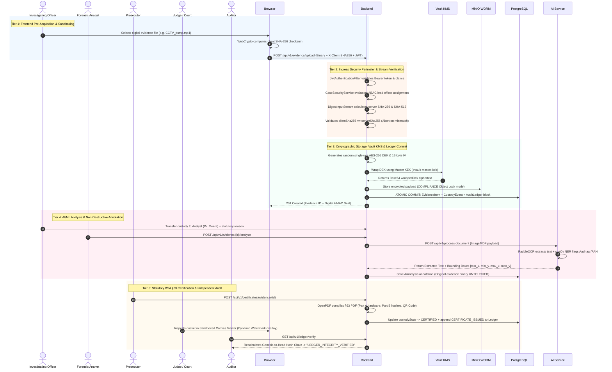

# Secure Digital Evidence & Legal Document Management System (E-Vault)
### Smart India Hackathon (SIH26190) — Nodal Ministry: Ministry of Home Affairs (MHA)

[](https://adoptium.net/)
[](https://spring.io/projects/spring-boot)
[](https://spring.io/projects/spring-security)
[](https://www.python.org/)
[](https://fastapi.tiangolo.com/)
[](https://github.com/PaddlePaddle/PaddleOCR)
[](https://www.postgresql.org/)
[](https://github.com/LibrePDF/OpenPDF)
[-success.svg?style=flat-square)]()
[]()

---

## 1. Executive Summary & Problem Context

The **Secure Digital Evidence and Legal Document Management System (E-Vault)** is an enterprise-grade, zero-trust platform engineered to secure the acquisition, storage, analysis, chain of custody, and legal certification of digital evidence and case files for Indian law enforcement agencies, forensic laboratories, prosecutors, and judicial courts.

### 1.1 The Systemic Problem (Problem Statement ID: SIH26190)
The Indian criminal justice lifecycle relies heavily on sensitive documentation—including First Information Reports (FIRs), Case Diaries, Seizure Memos, Charge Sheets, CCTV footage, phone extractions, and Forensic Laboratory (FSL) Reports. Currently, digitized legal records face three systemic vulnerabilities:

1. **Evidentiary Compromise**: Electronic evidence submitted in court is frequently rejected under **Section 63 of the Bharatiya Sakshya Adhiniyam, 2023 (BSA)** if the prosecution cannot prove an unbroken, tamper-evident chain of custody from the exact second of seizure.
2. **Insider Threat & Retroactive Tampering**: Database administrators or malicious insiders can silently alter, swap, or backdate evidence files in standard SQL databases without leaving an unalterable audit trail.
3. **Information Leaks & Data Exfiltration**: Uncontrolled file downloads, lack of view-only sandboxing, and missing attribute-based access controls lead to leaks of sensitive witness statements, victim identities, and active investigation strategies.

---

## 2. Statutory Legal Framework — BSA 2023 (§63)

Effective **July 1, 2024**, the Indian Parliament enacted the **Bharatiya Sakshya Adhiniyam, 2023 (BSA)**, replacing the Indian Evidence Act, 1872. Section 63 governs the **Admissibility of Electronic Records** (superseding the former Section 65B):

- **§63(2)** defines conditions under which computer outputs and digital prints are legally deemed admissible documents.
- **§63(4)** mandates that an official statutory certificate accompany every electronic record presented in court, declaring:
  1. Complete identification of the electronic record and production particulars.
  2. Device parameters (hardware make, model, serial number, operating system).
  3. Continuous lawful custody and proper device operation during extraction.
  4. Cryptographic hash snapshots establishing that the record has not been altered or tampered with.
  5. Official digital or physical signature of the certifying officer.

The E-Vault provides an **automated, cryptographically signed implementation of Section 63 BSA**, auto-generating Schedule-compliant court certificates while maintaining an append-only hash-chained audit ledger.

---

## 3. The Solution: Enterprise Forensic Vault Architecture

Rather than acting as a simple cloud file drive, the E-Vault treats every file as a **forensic artifact**:

```
                                  SYSTEM OVERVIEW
┌─────────────────────────────────────────────────────────────────────────────────┐
│                           Client Workstation / Browser                          │
│  • WebCrypto SHA-256 Pre-Hashing  • Sandboxed HTML5 Canvas  • Dynamic Watermark │
└────────────────────────────────────────┬────────────────────────────────────────┘
                                         │ mTLS / REST API (Bearer JWT)
                                         ▼
┌─────────────────────────────────────────────────────────────────────────────────┐
│                    Gateway & Security Perimeter (Spring Boot)                   │
│  • JWT Auth Filter  • RBAC Gates (7 Roles)  • ABAC Case Security Evaluator      │
└────────────────────────────────────────┬────────────────────────────────────────┘
                                         │
        ┌────────────────────────────────┼────────────────────────────────┐
        ▼                                ▼                                ▼
┌──────────────┐                 ┌──────────────┐                 ┌──────────────┐
│ Storage & KMS│                 │ Audit Ledger │                 │  AI/ML Engine│
│ • MinIO S3   │                 │ • SHA-256    │                 │ • Python     │
│   WORM Lock  │                 │   Hash Chain │                 │   FastAPI    │
│ • Vault KEK  │                 │ • 1-Click    │                 │ • PaddleOCR  │
│   AES DEK    │                 │   Verifier   │                 │ • PII NER    │
└──────────────┘                 └──────────────┘                 └──────────────┘
```

### Core Security Principles:
- **Client-Side Pre-Hashing**: Files are hashed client-side (WebCrypto SHA-256) prior to transmission, preventing in-flight payload corruption or man-in-the-middle manipulation.
- **Dual Server-Side Hash Sealing**: Backend calculates **SHA-256** and **SHA-512** on the fly during upload and compares against the client hash challenge.
- **Hardware WORM Object Storage**: Storage layer utilizes MinIO / S3 **Object Lock in COMPLIANCE mode**, physically blocking file deletion or modification for 7–30 years.
- **Vault KMS Envelope Encryption**: Payloads are encrypted with single-use `AES-256-GCM` Data Encryption Keys (DEKs). DEKs are wrapped with a master Key Encryption Key (KEK) via HashiCorp Vault.
- **Append-Only Hash-Chained Audit Ledger**: Every view, upload, transfer, download, or status change creates an immutable block linked by SHA-256 hash chains ($\text{entryHash}_n$).
- **Sandboxed Canvas Viewing & Dynamic Watermarking**: Documents are rendered onto an HTML5 canvas with indelible overlays (Officer Badge, IP, Timestamp) to prevent screenshot exfiltration.

---

## 4. Comprehensive Technology Stack & Services Used

| Layer / Subsystem | Technology | Version | Operational Purpose |
|---|---|---|---|
| **Runtime & Language** | Java LTS | 21 (`Temurin-21`) | Backend runtime, sealed interfaces, record classes, virtual threads |
| **Backend Framework** | Spring Boot | 4.1.1 | Enterprise REST APIs, autoconfiguration, dependency injection |
| **Security Perimeter** | Spring Security | Stateless JWT | Bearer token filter, RBAC method security, ABAC case scoping |
| **Persistence** | Spring Data JPA / Hibernate | ORM 7 | PostgreSQL data mapping, optimistic locking, audit entities |
| **Primary Database** | PostgreSQL | 16+ | Production relational database & append-only hash ledger |
| **Test Database** | H2 Database | In-Memory | Zero-dependency, ultra-fast test database (`MODE=PostgreSQL`) |
| **PDF Certificate Generator** | OpenPDF | 2.0.3 | Automated BSA 2023 §63 statutory PDF certificate generation |
| **API Documentation** | SpringDoc OpenAPI | 3.0 (Swagger UI) | Interactive REST API documentation and client sandbox |
| **AI/ML Runtime** | Python | 3.12 | Microservice runtime for heavy computer vision tasks |
| **AI Framework** | FastAPI + Uvicorn | 0.110+ | Asynchronous REST microservice for OCR and NER processing |
| **OCR Computer Vision** | PaddleOCR | v3.7+ | Structural layout analysis & text extraction from scanned documents |
| **Legal NER Engine** | spaCy + Regex | Custom | Detection of Indian PII (Aadhaar, PAN, Phone) & statutory IPC sections |
| **WORM Object Storage** | MinIO / AWS S3 | S3 API | Object Lock COMPLIANCE retention mode (Write-Once-Read-Many) |
| **Key Management (KMS)** | HashiCorp Vault | Transit Engine | Envelope encryption, master KEK wrapping & unwrapping of per-file DEKs |
| **Search Engine** | Hybrid OpenSearch | REST Client | Lexical BM25 & dense vector k-NN similarity search over OCR text |
| **RFC 3161 Timestamping (TSA)** | BouncyCastle (`bcprov` / `bcpkix`) | 1.78.1 | Cryptographic 3rd-party non-repudiation timestamps on evidence & certificates |
| **Real-Time WebSockets** | Spring WebSocket + STOMP | 4.1.1 | Instant security alarm broadcasting and case activity streams |

---

## 5. End-to-End Application Workflow (5-Tier Zero-Trust Architecture)

The E-Vault operates across a highly coordinated, **5-Tier Architecture** to guarantee zero-trust security, strict data confidentiality, and unbroken chain-of-custody auditability from field acquisition to judicial trial.



---

### Tier-by-Tier Operational Specification

---

### 🌐 Tier 1: Frontend Client Pre-Acquisition & Sandboxed Viewing Layer

| Attribute | Specification |
|---|---|
| **Primary Scope** | Client-side pre-hashing, sandboxed document viewing, dynamic forensic watermarking |
| **Technologies Used** | Next.js / React 18, WebCrypto API, HTML5 Canvas, PDF.js |
| **Security Controls** | Pre-transmission SHA-256 calculation, right-click & drag prevention, dynamic watermark overlay |
| **Data In / Out** | **Input**: Raw evidence file selected by user <br> **Output**: HTTP payload + `X-Client-SHA256` header + Bearer JWT |

#### Key Mechanics:
1. **Client-Side SHA-256 Pre-Hashing**: Before network streaming begins, the browser calculates a 64-character hex checksum (`clientSha256`) using native `crypto.subtle.digest('SHA-256', buffer)`. This is sent in the `X-Client-SHA256` HTTP header for in-flight integrity validation.
2. **Sandboxed HTML5 Canvas Viewer**: Documents and evidence scans are rendered onto an HTML5 Canvas target via PDF.js. Direct PDF downloads, text selection, printing, and context menus are strictly disabled.
3. **Dynamic Forensic Watermarking**: Draws an indelible diagonal overlay across canvas pixels displaying the viewing officer's badge number, station code, IP address, and access timestamp to prevent smartphone screen photography leaks.

> [!NOTE]
> Client-side hashing provides early integrity assurance; the server independently recalculates all digests before persisting data.

---

### 🛡️ Tier 2: Ingress Security Perimeter & Stream Verification Layer

| Attribute | Specification |
|---|---|
| **Primary Scope** | JWT authentication, RBAC method security, ABAC case scoping, streaming dual-digest validation |
| **Technologies Used** | Java 21, Spring Security, JJWT (HMAC-SHA256), Spring `DigestInputStream` |
| **Security Controls** | Token signature verification, 7-role RBAC gates, lead officer ABAC evaluation, streaming hash match |
| **Data In / Out** | **Input**: Multipart file request + JWT + `clientSha256` <br> **Output**: Verified byte stream + server SHA-256/512 digests |

#### Key Mechanics:
1. **Stateless JWT Validation**: `JwtAuthenticationFilter` validates token signatures and claims, extracting `userId`, `role`, and `department`.
2. **Role & Attribute-Based Authorization**:
   - **RBAC Gate**: Method security (`@PreAuthorize("hasRole('INVESTIGATING_OFFICER')")`) verifies action permissions.
   - **ABAC Gate**: `CaseSecurityService` verifies lead officer assignment, active case status (`OPEN` or `UNDER_INVESTIGATION`), and police station jurisdiction.
3. **Streaming Dual-Digest Verification**: Spring `DigestInputStream` reads incoming bytes, calculating SHA-256 and SHA-512 in a single pass. If `serverSha256 != clientSha256`, the connection terminates immediately with `400 Bad Request`.

---

### 🔒 Tier 3: Cryptographic Storage, Vault KMS & Ledger Engine Tier

| Attribute | Specification |
|---|---|
| **Primary Scope** | Envelope encryption, Master KEK wrapping, S3 WORM Object Locking, hash-chained ledger commit |
| **Technologies Used** | AES-256-GCM, HashiCorp Vault Transit Engine, MinIO / AWS S3 WORM, PostgreSQL |
| **Security Controls** | Single-use DEK per file, Object Lock COMPLIANCE mode, `@Column(updatable = false)` immutability |
| **Data In / Out** | **Input**: Validated evidence stream <br> **Output**: Encrypted WORM object + wrapped DEK + immutable `audit_ledger` block |

#### Key Mechanics:
1. **AES-256-GCM Payload Encryption**: Generates a random single-use Data Encryption Key (DEK). Encrypts binary stream using `AES-256-GCM` with a 12-byte random Initialization Vector (IV).
2. **Vault KMS Key Wrapping**: Invokes HashiCorp Vault Transit Engine (`POST /v1/transit/encrypt/evault-master-kek`) to wrap the DEK under a master Key Encryption Key (KEK), returning Base64 `wrappedDek`.
3. **Hardware WORM Storage**: `S3WormStorageService` stores ciphertext in MinIO / S3 configured with **Object Lock in COMPLIANCE mode** (e.g. 365-day retention), physically blocking deletion or modification.
4. **Atomic Hash-Chained Audit Ledger Commit**: Executes database write under a single `@Transactional` commit gate, generating an immutable transaction block:
   $$\text{entryHash}_n = \text{SHA-256}(\text{seq}_n \parallel \text{occurredAt}_n \parallel \text{actorId}_n \parallel \text{action}_n \parallel \text{resourceRef}_n \parallel \text{details}_n \parallel \text{entryHash}_{n-1})$$

> [!IMPORTANT]
> The ledger block commit is atomic: evidence record, custody event, and hash chain block execute in one database transaction.

---

### 🤖 Tier 4: AI/ML Microservice Subsystem (Python FastAPI)

| Attribute | Specification |
|---|---|
| **Primary Scope** | OCR text extraction, PII entity recognition, spatial bounding box coordinate generation |
| **Technologies Used** | Python 3.12, FastAPI, PaddleOCR v3.7+, spaCy, OpenCV, Regex Engine |
| **Security Controls** | Isolated micro-worker execution, non-destructive annotation storage (original binary untouched) |
| **Data In / Out** | **Input**: Document image binary <br> **Output**: JSON OCR text + PII bounding boxes `[min_x, min_y, max_x, max_y]` |

#### Key Mechanics:
1. **PaddleOCR Structural Layout Analysis**: Asynchronously processes document images, extracting line coordinates, structural layouts, and raw text.
2. **Statutory PII & Legal NER Engine**: Scans text for Indian regulatory identifiers (12-digit Aadhaar, 10-char PAN, phone numbers, email addresses, IPC/BNS sections).
3. **Non-Destructive Annotation Linking**: Returns spatial 2D bounding box coordinates stored in `AiAnalysis` entities. The original evidence binary on WORM storage remains 100% untouched.

---

### 📜 Tier 5: Statutory BSA 2023 §63 Certification & Independent Audit Tier

| Attribute | Specification |
|---|---|
| **Primary Scope** | BSA 2023 §63 court PDF certificate generation, whole-ledger cryptographic audit verification |
| **Technologies Used** | OpenPDF 2.0.3, PostgreSQL, QR Code Generator, WebSockets |
| **Security Controls** | Cryptographic hash binding, statutory legal declaration, genesis-to-head chain verification |
| **Data In / Out** | **Input**: Certified evidence ID <br> **Output**: Court-admissible signed PDF + QR verification seal + whole-ledger status |

#### Key Mechanics:
1. **Automated BSA §63 Certificate Generation**: Compiles case details, hardware parameters, acquisition date, SHA-256/512 hashes, HMAC seal, and custody timeline into an official PDF per BSA 2023 §63 schedule (Part A hardware, Part B hashes, QR Code).
2. **Whole-Ledger Cryptographic Audit**: Auditors execute `GET /api/v1/ledger/verify`. The system recalculates SHA-256 block hashes sequentially from genesis block ($n=1$) to head ($n=N$). If intact, returns **`LEDGER_INTEGRITY_VERIFIED`** seal; if tampered, pinpoints exact `brokenSeq`.

> [!TIP]
> The generated §63 PDF contains a verifiable QR code linking directly to the system's ledger verification endpoint for courtroom verification.

---

## 6. Feasibility, Viability & Technical Challenges

### 6.1 System Feasibility
- **Modular Architecture**: Built as a modular monolith in Spring Boot paired with a lightweight Python microservice. This guarantees hackathon-speed delivery and low maintenance while maintaining clean package boundaries for future microservice extraction.
- **Standards Compliance**:
  - **BSA 2023 §63**: Statutory certificate automation for court admissibility.
  - **ISO/IEC 27037**: Digital evidence collection, acquisition, and preservation.
  - **NIST SP 800-38D**: AES-GCM specification for authenticated envelope encryption.
  - **RFC 6962 / RFC 3161**: Hash-chained audit structures and trusted timestamping.

### 6.2 System Viability
- **Operational Scalability**: Uses streaming byte channels during file ingest to handle multi-gigabyte phone dumps without memory overflow.
- **Zero-Dependency Resilience**: Storage, KMS, and Search subsystems feature resilient fallback adapters (local directory storage fallback, local AES KEK fallback, JPA multi-column DB search fallback) ensuring the core backend runs seamlessly even if external enterprise servers are offline.

### 6.3 Technical Challenges Faced & Engineering Solutions

| Challenge Experienced | Technical Cause | Engineering Solution Implemented |
|---|---|---|
| **PaddleOCR Win32 CPU Thread Crash** | PaddlePaddle 3.3+ PIR executor hits oneDNN/MKLDNN attribute conversion error on Windows CPU. | Implemented runtime environment overrides (`PADDLE_PDX_ENABLE_MKLDNN_BYDEFAULT=0`) and explicit `enable_mkldnn=False` initialization parameters in `ocr_service.py`. |
| **Audit Ledger Race Conditions** | Concurrent uploads could attempt to link to the same previous block hash. | Enforced database sequence locking (`BIGSERIAL`) and atomic single-transaction commit gates where evidence write, custody event, and ledger append execute in one database transaction. |
| **Large Evidence Ingest Memory Spikes** | Loading multi-gigabyte binaries into RAM causes OutOfMemory (OOM) errors. | Replaced in-memory byte arrays with Spring `DigestInputStream` streaming channels, computing SHA-256/512 checksums as bytes pass directly to storage. |
| **Statutory PDF Layout Rigidity** | Traditional PDF libraries alter layout when inserting dynamic hash values or tables. | Implemented OpenPDF with fixed table cell heights, monospace font formatting for cryptographic hashes, and automated page numbering. |

---

## 7. Impact & Stakeholder Benefits

```
┌─────────────────────────────────────────────────────────────────────────────────┐
│                              STAKEHOLDER BENEFITS                               │
├───────────────────┬─────────────────────────────────────────────────────────────┤
│ Stakeholder       │ Impact & Direct Operational Benefit                         │
├───────────────────┼─────────────────────────────────────────────────────────────┤
│ **Judicial Courts**│ • Zero evidence rejections under BSA 2023 §63.             │
│                   │ • 1-Click statutory certificate verification with QR seal.  │
├───────────────────┼─────────────────────────────────────────────────────────────┤
│ **Investigating   │ • Automated dual-hash sealing at instant of seizure.        │
│   Officers (IOs)**│ • Seamless custody handoffs with statutory logging.         │
├───────────────────┼─────────────────────────────────────────────────────────────┤
│ **Forensic Labs   │ • Fast automated OCR text extraction & PII entity detection.│
│   (FSL)**         │ • Physical disk integrity re-verification (`/verify-integrity`).│
├───────────────────┼─────────────────────────────────────────────────────────────┤
│ **Public          │ • Streamlined trial bundle assembly with version history.   │
│   Prosecutors**   │ • Instant cross-case search over legal documents and OCR.   │
├───────────────────┼─────────────────────────────────────────────────────────────┤
│ **Independent     │ • Whole-ledger cryptographic verification catching insider   │
│   Auditors**      │   database modification (`GET /api/v1/ledger/verify`).    │
└───────────────────┴─────────────────────────────────────────────────────────────┘
```

---

## 8. API Reference Summary

Base URL: `http://localhost:8080/api/v1`

### 8.1 Authentication & Profile (`/auth`)
- `POST /api/v1/auth/register` — Onboard user account with assigned role (`RegisterRequest`).
- `POST /api/v1/auth/login` — Authenticate credentials, returning JWT token (`LoginRequest`).
- `GET /api/v1/auth/me` — Retrieve current authenticated actor profile.

### 8.2 Case Docket Management (`/cases`)
- `POST /api/v1/cases` — Initialize criminal case docket (`CreateCaseRequest`).
- `GET /api/v1/cases/{id}` — Get case docket details by ID.
- `GET /api/v1/cases/number/{caseNumber}` — Get case by FIR/case number.
- `GET /api/v1/cases` — List all cases (optional status filter).
- `PATCH /api/v1/cases/{id}/status` — Transition case status state machine.

### 8.3 Evidence Ingestion & Cryptography (`/evidence`)
- `POST /api/v1/evidence/upload` — Ingest evidence with streaming SHA-256/512 sealing (`multipart/form-data`).
- `GET /api/v1/evidence/{id}` — Retrieve evidence metadata & hash snapshots.
- `GET /api/v1/evidence/case/{caseId}` — List all evidence items in a case docket.
- `GET /api/v1/evidence/{id}/download` — Stream raw evidence binary file.
- `POST /api/v1/evidence/{id}/verify-integrity` — Re-read disk file & verify SHA-256 hash match.

### 8.4 AI Analysis & Processing (`/evidence/{evidenceId}/*`)
- `POST /api/v1/evidence/{evidenceId}/analyze` — Dispatch evidence to Python AI microservice.
- `GET /api/v1/evidence/{evidenceId}/analysis` — Retrieve AI OCR text, PII, and bounding box coordinates.

### 8.5 Chain of Custody (`/evidence/{id}/custody*`)
- `POST /api/v1/evidence/{id}/custody-transfer` — Record signed officer custody handoff (`CustodyTransferRequest`).
- `GET /api/v1/evidence/{id}/custody` — Retrieve complete chronological custody timeline.

### 8.6 Audit Ledger (`/ledger`)
- `GET /api/v1/ledger/verify` — Execute whole-ledger cryptographic hash chain verification.
- `GET /api/v1/ledger/entries` — List all immutable ledger transaction blocks.

### 8.7 Statutory BSA §63 Certification (`/certificates`)
- `POST /api/v1/certificates/evidence/{evidenceId}` — Issue statutory BSA 2023 §63 PDF certificate (`IssueCertificateRequest`).

### 8.8 Search Engine (`/search`)
- `GET /api/v1/search?query={term}&type={ALL|CASE|EVIDENCE|DOCUMENT}` — Execute hybrid search.

### 8.9 Real-Time WebSockets & Security Alarms (`/alarms` & `/ws-evault`)
- `WS /ws-evault` / `/ws` — STOMP WebSocket connection endpoint (SockJS fallback + JWT authentication).
- `SUB /topic/security/alarms` — Real-time security alarms feed (Restricted to `SYSTEM_ADMIN` & `AUDITOR`).
- `SUB /topic/case/{id}` — Real-time docket activity events for assigned case.
- `GET /api/v1/alarms` — List security alarms (filterable by acknowledgment status).
- `GET /api/v1/alarms/count-unacknowledged` — Unacknowledged alarm badge count.
- `POST /api/v1/alarms/{id}/acknowledge` — Acknowledge an active security alarm (`AUDITOR` / `SYSTEM_ADMIN`).
- `POST /api/v1/alarms/trigger-test` — Trigger security drill alarm for auditor testing.

### 8.10 RFC 3161 Trusted Timestamp Authority (`/timestamp`)
- `POST /api/v1/timestamp/stamp-hash` — Generate certified RFC 3161 Time-Stamp Token (TST) for SHA-256 hash.
- `POST /api/v1/timestamp/verify` — Cryptographically verify Base64 RFC 3161 token against expected hash.
- `GET /api/v1/timestamp/evidence/{id}` — Retrieve and verify RFC 3161 token recorded during evidence intake.
- `GET /api/v1/timestamp/certificate/{id}` — Retrieve and verify RFC 3161 token recorded on BSA §63 certificate.

---

## 9. Local Setup & Execution Guide

### Prerequisites
- **Java 21 LTS** (`openjdk-21`)
- **Maven 3.9+** (or use `./mvnw`)
- **Python 3.12+** (with `pip`)
- **PostgreSQL 16+** (Optional: H2 in-memory DB is active by default for development/testing)

### Step 1: Run Backend Unit & Integration Tests
```bash
cd backend
./mvnw clean test
```
*(All 67 tests will run and pass).*

### Step 2: Start Backend Application
```bash
cd backend
./mvnw spring-boot:run
```
- **REST Base URL**: `http://localhost:8080/api/v1`
- **Swagger UI API Docs**: [http://localhost:8080/swagger-ui/index.html](http://localhost:8080/swagger-ui/index.html)

### Step 3: Start AI/ML Microservice
```bash
cd AIML
python3 -m venv venv
source venv/bin/activate  # On Windows: venv\Scripts\activate
pip install -r requirements.txt
uvicorn main:app --host 0.0.0.0 --port 8000 --reload
```
- **AI Microservice URL**: `http://localhost:8000`
- **AI OpenAPI Docs**: [http://localhost:8000/docs](http://localhost:8000/docs)

---

*SIH26190 E-Vault — Built for Smart India Hackathon. Nodal Ministry: Ministry of Home Affairs (MHA).*