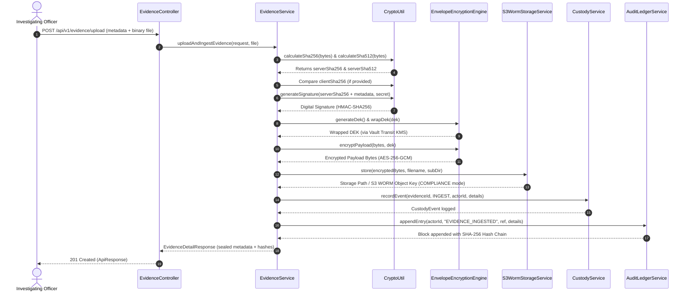
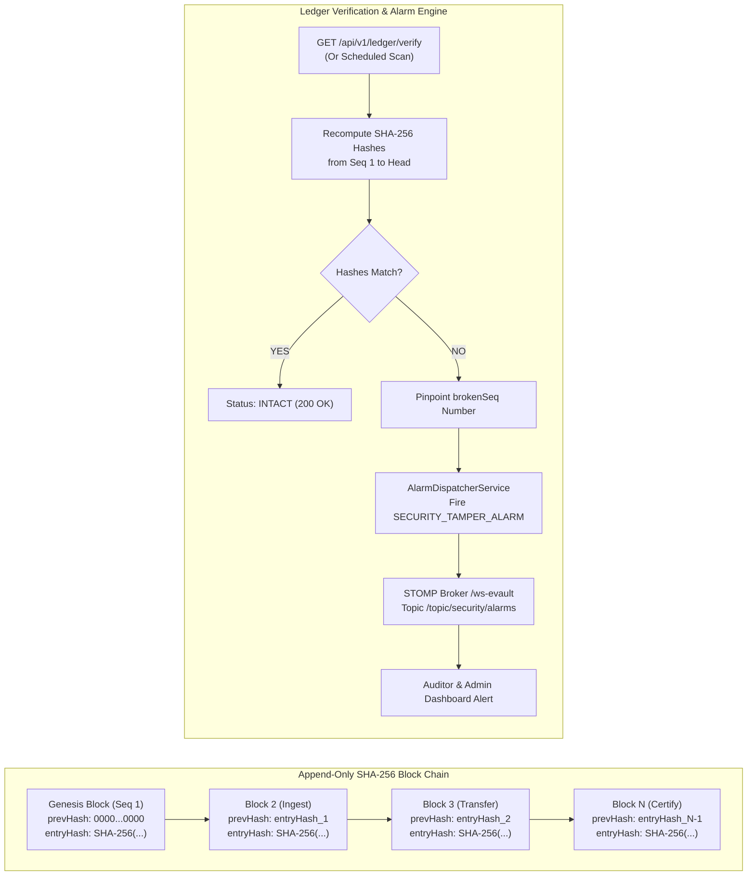
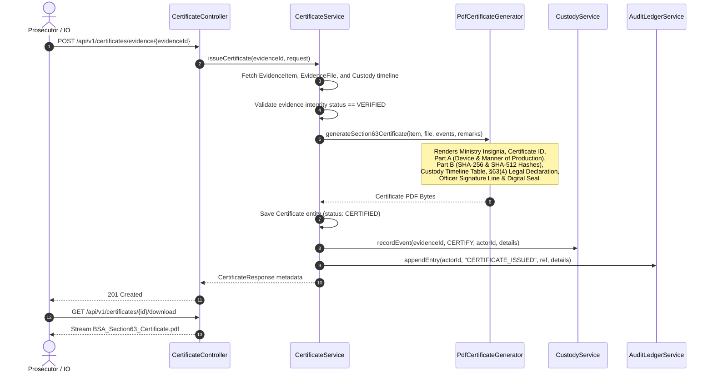
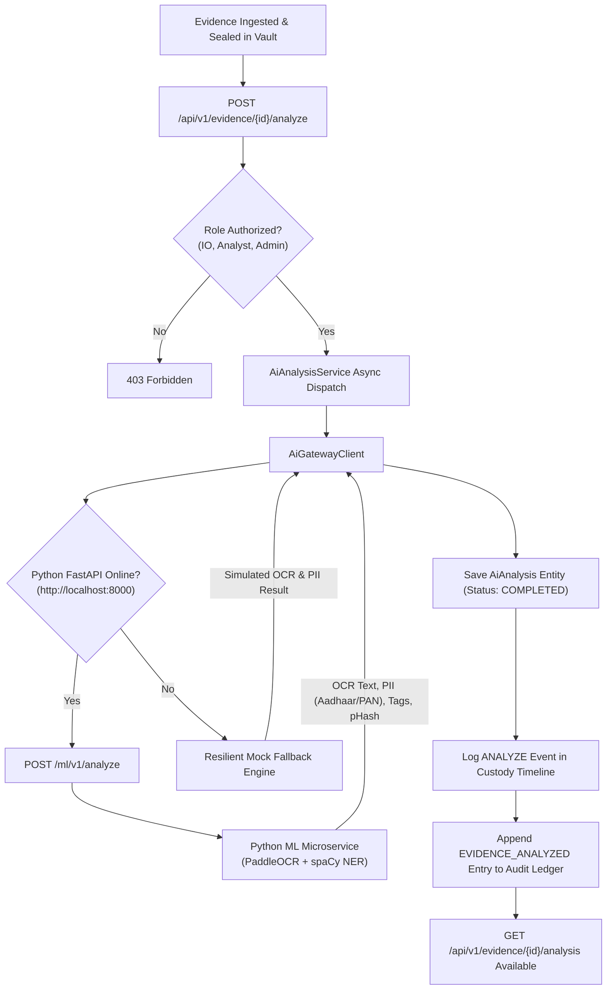
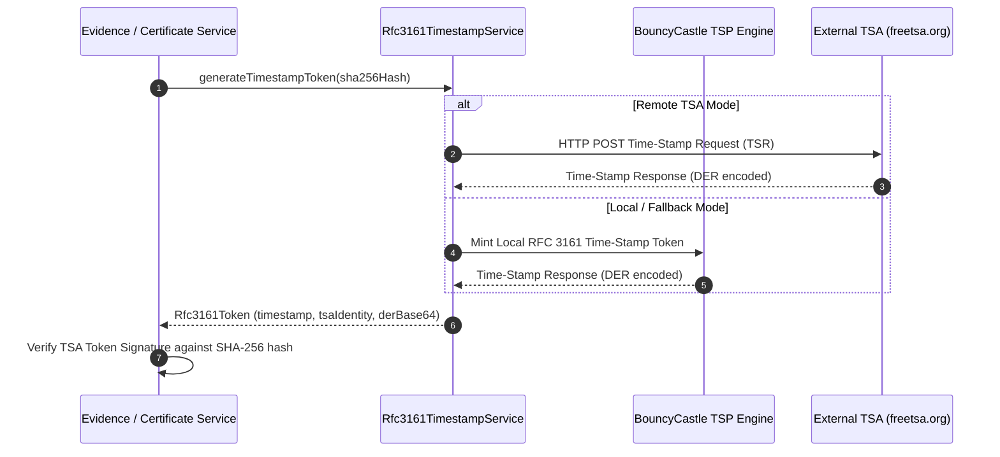

# Secure Digital Evidence & Legal Document Management System (E-Vault)
### Smart India Hackathon (SIH26190) — Backend Subsystem

[](https://adoptium.net/)
[](https://spring.io/projects/spring-boot)
[](https://spring.io/projects/spring-security)
[](https://www.postgresql.org/)
[](https://github.com/LibrePDF/OpenPDF)
[](http://localhost:8080/swagger-ui/index.html)
[-success.svg?style=flat-square)]()
[]()

---

## 1. Executive Summary & Legal Statutory Context

The **Secure Digital Evidence and Legal Document Management System (E-Vault)** is an enterprise-grade backend designed to secure the integrity, chain of custody, and statutory admissibility of digital evidence and legal case files for law enforcement agencies, digital forensic laboratories, prosecutors, and judicial courts across India.

### The Core Problem
In modern criminal investigations, digital evidence (CCTV footage, hard drive bit-stream images, seized smartphones, financial server logs, CDRs) faces three critical risks:
1. **Chain-of-Custody Ambiguity**: Lack of an immutable, cryptographically signed log showing who possessed, transferred, analyzed, or accessed evidence.
2. **Silent File Alteration & Bit-Rot**: Unnoticed bit degradation or malicious tampering on physical disks or cloud storage.
3. **Statutory Admissibility Rejection**: Discarding of critical digital evidence by courts due to non-compliance with statutory certification mandates.

### Statutory Compliance: Bharatiya Sakshya Adhiniyam, 2023 (§63)
Effective July 1, 2024, the Parliament of India enacted the **Bharatiya Sakshya Adhiniyam, 2023 (BSA)**, replacing the Indian Evidence Act, 1872. Section 63 governs the **Admissibility of Electronic Records** (superseding former Section 65B):
- **§63(2)** establishes statutory requirements for computer output admissibility.
- **§63(4)** mandates an official statutory certificate containing:
  - Device particulars (make, model, serial number) and location of seizure.
  - Manner of production and custody trail held by the officer in charge.
  - Dual cryptographic hash snapshots (SHA-256 & SHA-512) ensuring non-tampering.
  - Digital signatures of the certifying officer and automated digital verification seals.

This platform automates **Section 63 BSA compliance**, generating Schedule-compliant court certificate PDFs while enforcing an append-only, hash-chained audit ledger.

---

## 2. System Architecture & Component Interactions

The backend follows an enterprise layered architecture strictly adhering to the Single Responsibility Principle:

```mermaid
flowchart TD
  subgraph ClientLayer["1. Client & Integration Portal"]
    WebClient["Web Application (React / Next.js)"]
    MobileApp["Mobile Field Acquisition Unit"]
    eCourts["e-Courts Judicial Interface API"]
  end

  subgraph GatewayLayer["2. Security & Gateway Perimeter"]
    SecFilter["Spring Security Filter Chain\n(Stateless, CORS, CSRF Disabled)"]
    JwtAuth["JwtAuthenticationFilter\n(HMAC-SHA256 Token Validation)"]
    ActorCtx["ActorContextHolder\n(ThreadLocal Identity Bridge)"]
  end

  subgraph ControllerLayer["3. REST API Controllers (/api/v1) & STOMP"]
    AuthCtrl["AuthController\n(/auth)"]
    CaseCtrl["CaseController\n(/cases)"]
    EvidCtrl["EvidenceController\n(/evidence)"]
    CustCtrl["CustodyController\n(/evidence/{id}/custody)"]
    LedgCtrl["LedgerController\n(/ledger)"]
    DocCtrl["LegalDocumentController\n(/documents)"]
    CertCtrl["CertificateController\n(/certificates)"]
    SearchCtrl["SearchController\n(/search)"]
    AlarmCtrl["SecurityAlarmController\n(/alarms & STOMP /ws-evault)"]
    TsCtrl["TimestampController\n(/timestamp)"]
    UserCtrl["UserController\n(/users)"]
  end

  subgraph ServiceLayer["4. Core Service & Cryptographic Engine"]
    AuthSvc["AuthService & CustomUserDetailsService"]
    CaseSvc["CaseService & CaseSecurityService (ABAC)"]
    EvidSvc["EvidenceService & CryptoUtil (SHA-256/512)"]
    CustSvc["CustodyService (HMAC Timeline)"]
    LedgSvc["AuditLedgerService (Hash Chain)"]
    DocSvc["LegalDocumentService (Versioning)"]
    CertSvc["CertificateService & PdfCertificateGenerator"]
    WormSvc["S3WormStorageService (Object Lock COMPLIANCE)"]
    KmsSvc["EnvelopeEncryptionEngine & VaultKmsClientService"]
    AlarmSvc["AlarmDispatcherService (STOMP Broker)"]
    TsSvc["Rfc3161TimestampService (BouncyCastle TSP)"]
    SearchSvc["OpenSearchClientService (Hybrid Search)"]
  end

  subgraph ExternalLayer["5. External Microservices & Services"]
    FastApiML["Python FastAPI AI/ML Microservice\n(PaddleOCR, spaCy PII, pHash)"]
    VaultKMS["HashiCorp Vault Transit Engine\n(Master KEK Management)"]
    TsaRemote["RFC 3161 Time-Stamp Authority (TSA)"]
  end

  subgraph PersistenceLayer["6. Data & File Storage Tier"]
    JPA["Spring Data JPA Repositories"]
    PostgresDB[("PostgreSQL / H2 In-Memory DB")]
    OpenSearchCluster[("OpenSearch Hybrid Index")]
    ObjectStore[("Partitioned Blobs / MinIO / S3 WORM\n(./data/uploads)")]
  end

  ClientLayer --> GatewayLayer
  GatewayLayer --> ControllerLayer
  ControllerLayer --> ServiceLayer
  ServiceLayer --> ExternalLayer
  ServiceLayer --> PersistenceLayer
```



---

## 3. End-to-End System Workflows

### 3.1 Evidence Ingestion, Dual Hashing & KMS Envelope Encryption



---

### 3.2 Append-Only Hash Chain Ledger & Tamper Alert Workflow



---

### 3.3 Statutory BSA 2023 §63 Certificate Generation Workflow



---

### 3.4 AI/ML Evidence Analysis & Enrichment Workflow



---

### 3.5 RFC 3161 Trusted Timestamping (TSA) Workflow



---

## 4. Technology Stack

| Layer | Technology | Purpose |
|---|---|---|
| **Runtime & Language** | Java 21 LTS (`Temurin-21`) | Modern Java runtime, Records, Pattern Matching, Sealed Classes |
| **Framework** | Spring Boot 4.1.1 | Core application framework and autoconfiguration |
| **Web MVC & WebSockets** | Spring Web MVC + Spring WebSocket | RESTful API controllers, multipart streaming, STOMP real-time messaging |
| **Security** | Spring Security 6/7 + JJWT 0.12.6 | Stateless JWT authentication, RBAC, Case-level ABAC |
| **Cryptographic Timestamping** | BouncyCastle 1.78.1 (`bcpkix` / `bcprov`) | RFC 3161 Time-Stamp Protocol (TSP) for non-repudiation time tokens |
| **Envelope Encryption** | HashiCorp Vault Transit KMS | AES-256-GCM DEK generation, master KEK wrapping & unwrapping |
| **Object Storage** | MinIO / AWS S3 WORM | Object Lock COMPLIANCE mode hardware-enforced immutability |
| **Persistence** | Spring Data JPA + Hibernate ORM 7 | Object-relational mapping, custom repositories, optimistic locking |
| **Primary Database** | PostgreSQL 16+ | Production relational database (Neon Cloud / Local) |
| **Test Database** | H2 In-Memory (`MODE=PostgreSQL`) | Zero-dependency, ultra-fast test database |
| **PDF Generation** | OpenPDF 2.0.3 | Statutory BSA 2023 §63 court certificate PDF generation |
| **API Documentation** | SpringDoc OpenAPI 3.0 / Swagger UI | Interactive OpenAPI explorer and REST client UI |
| **Boilerplate Reduction** | Project Lombok | Auto-generation of getters, setters, builders, and loggers |
| **Build Tool** | Apache Maven Wrapper (`./mvnw`) | Dependency management, compilation, and automated test execution |

---

## 5. Subsystems Built & Verified (Chunks 1–11)

### Chunk 1: Foundation, Database & Case Management
- **Base Infrastructure**: Standardized RFC 7807 problem details in `GlobalExceptionHandler`, unified envelope `ApiResponse<T>`, and `ActorContextHolder` capturing thread-safe actor identity.
- **Role Hierarchy**: `RoleEnum` with granular roles:
  - `INVESTIGATING_OFFICER` — Case registration, evidence intake, handover.
  - `FORENSIC_ANALYST` — Extraction, packet analysis, hash verification.
  - `PROSECUTOR` — Document review, trial bundle assembly, certificate filing.
  - `COURT` — Judicial review, digital docket inspection, certificate download.
  - `AUDITOR` — Whole-ledger cryptographic integrity auditing.
  - `RECORDS_CUSTODIAN` — Physical and digital vault inventory management.
  - `SYSTEM_ADMIN` — System administration and tenant user lifecycle.
- **Case Docket Lifecycle**: `Case` entity tracking FIR numbers, jurisdiction, lead investigating officer, assigned officers, and status state machine:
  $$\text{OPEN} \longrightarrow \text{UNDER\_INVESTIGATION} \longrightarrow \text{CHARGESHEET\_FILED} \longrightarrow \text{IN\_COURT} \longrightarrow \text{CLOSED} \longrightarrow \text{ARCHIVED}$$

### Chunk 2: Evidence Intake & Cryptographic Storage Subsystem
- **Dual Cryptographic Hashing**:
  - Computes streaming **SHA-256** (256 bits, 64 hex characters) and **SHA-512** (512 bits, 128 hex characters) at the exact moment of ingestion.
  - Validates against `clientSha256` (if provided by field acquisition software) to detect in-transit transmission corruption or tampering.
- **Digital Signatures**: Computes HMAC-SHA256 server signatures over raw binaries.
- **Storage Partitioning**: `LocalStorageService` partitions evidence blobs under `./data/uploads/cases/{caseId}/evidence/{evidenceId}/` with directory-traversal prevention.
- **Physical Integrity Verification**:
  - `POST /api/v1/evidence/{id}/verify-integrity`: Re-reads the file from disk, recalculates SHA-256 on the fly, compares against the ingestion hash snapshot, and flags any disk alteration or bit rot.

### Chunk 3: Tamper-Evident Append-Only Audit Ledger & Chain of Custody
- **Cryptographic Hash Chain Formula**:
  Every database modification (upload, transfer, view, certificate issuance) appends an immutable block into `audit_ledger`:
  $$\text{entryHash}_n = \text{SHA-256}(\text{seq}_n \parallel \text{occurredAt}_n \parallel \text{actorId}_n \parallel \text{action}_n \parallel \text{resourceRef}_n \parallel \text{details}_n \parallel \text{entryHash}_{n-1})$$
  - Genesis block ($n=1$) links to `0000000000000000000000000000000000000000000000000000000000000000`.
  - Database columns are annotated with `@Column(updatable = false)` to prevent JPA updates.
- **Whole-Ledger Cryptographic Audit (`GET /api/v1/ledger/verify`)**:
  - Recursively recomputes all SHA-256 hashes from genesis block to head.
  - If a malicious database administrator modifies even one byte of historical data directly in SQL, the verification algorithm instantly detects the violation and pinpoints the exact sequence number (`brokenSeq`).
- **Chain of Custody**:
  - Tracks all lifecycle events: `INGEST`, `TRANSFER`, `VIEW`, `DOWNLOAD`, `ANALYZE`, `CERTIFY`, `DISPOSE`.
  - `POST /api/v1/evidence/{id}/custody-transfer`: Records officer handoffs with mandatory statutory justifications.
  - `GET /api/v1/evidence/{id}/custody`: Returns a court-ready chronological custody timeline.

### Chunk 4: Legal Document Management & Versioning
- **Legal Document Types**: `FIR`, `CASE_DIARY`, `SEARCH_WARRANT`, `CHARGE_SHEET`, `SEIZURE_MEMO`, `FORENSIC_REPORT`, `BAIL_APPLICATION`, `COURT_ORDER`.
- **Immutable Version History**:
  - Each document tracks an incrementing version number ($v1, v2, \dots, vN$).
  - Every amended version records its own unique SHA-256 hash, upload timestamp, uploading officer, and change summary.
  - Enables downloading specific revisions (e.g., initial charge sheet vs. supplementary charge sheet).

### Chunk 5: Statutory Evidence Certification (BSA 2023 §63)
- **Official Schedule Format**:
  - Auto-generates official PDF certificates formatted strictly according to the statutory Schedule under Section 63 of the Bharatiya Sakshya Adhiniyam, 2023:
    - **Official Header**: Ministry of Home Affairs / Police Department insignia and formal certificate identifier (`CERT-BSA63-...`).
    - **Metadata Block**: Case/FIR number, court jurisdiction, date, and certifying officer badge number.
    - **Part A (Particulars of Device & Extraction)**: Hardware device make, model, serial number, seizure timestamp, extraction software, and manner of production.
    - **Part B (Cryptographic Hash Snapshot)**: Prominent monospace display of SHA-256 and SHA-512 hashes, plus HMAC digital signature ID.
    - **Chain of Custody Table**: Complete chronological event history including seizure, ingest, handovers, and forensic access.
    - **Statutory Declaration under §63(4)**: Mandatory legal declaration asserting system integrity, lack of tampering, and lawful custody during extraction.
    - **Signature Blocks**: Official certifying officer signature line and automated digital verification seal.
- **Lifecycle Automation**:
  - Issuing a certificate automatically updates evidence `custodyState` to `CERTIFIED`.
  - Records a `CERTIFY` event into the chain of custody.
  - Appends an audit record (`CERTIFICATE_ISSUED`) into the immutable hash ledger.

### Chunk 6: Authentication & Role-Based Access Control (Security)
- **Stateless JWT Engine**:
  - Uses `io.jsonwebtoken` (JJWT 0.12.6) with HMAC-SHA256 signature verification.
  - JWT tokens encode `sub` (username), `userId` (UUID), `role` (`RoleEnum`), `email`, and configurable expiration.
- **Password Security**:
  - Salted and hashed passwords stored using `BCryptPasswordEncoder`.
- **Authentication Endpoints**:
  - `POST /api/v1/auth/register`: Onboards users with role assignment and returns initial Bearer token.
  - `POST /api/v1/auth/login`: Validates credentials with BCrypt verification and issues Bearer token.
  - `GET /api/v1/auth/me`: Retrieves current authenticated actor profile.
- **Role-Based Access Control (RBAC)**:
  - Secured via Spring Security `@PreAuthorize` method security.
  - Example: `POST /api/v1/cases` is restricted to `INVESTIGATING_OFFICER` and `SYSTEM_ADMIN`; a `FORENSIC_ANALYST` receives `403 Forbidden`.
  - Example: `/api/v1/ledger/entries` is restricted to `AUDITOR` and `SYSTEM_ADMIN`.
- **Attribute-Based Access Control (ABAC)**:
  - `CaseSecurityService.java`: Verifies whether an investigating officer is the lead officer or an assigned team member for a specific case ID before granting mutation rights.
  - Unassigned officers attempting to alter case status receive `403 Forbidden`.

### Chunk 7: AI/ML Gateway Integration Subsystem
- **AI Evidence Analysis**:
  - `AiAnalysis` entity linked to `EvidenceItem` with status tracking (`PENDING`, `PROCESSING`, `COMPLETED`, `FAILED`).
  - Extracts OCR text, detects PII entities (Aadhaar numbers, PAN cards, phone numbers), applies auto-classification tags, computes perceptual hash (pHash), and calculates ML confidence scores.
- **Microservice Gateway Client**:
  - `AiGatewayClient.java`: Communicates with the external Python FastAPI ML microservice at `http://localhost:8000`. Features resilient mock fallback logic for zero-dependency execution if the Python service is offline.
- **Custody & Ledger Audit Integration**:
  - Triggering analysis (`POST /api/v1/evidence/{evidenceId}/analyze`) automatically logs an `ANALYZE` event in `CustodyService` and appends an `EVIDENCE_ANALYZED` transaction block into the immutable `AuditLedger`.
- **Immutability Guarantee**:
  - Raw evidence files and primary SHA-256/SHA-512 hashes remain untouched; AI annotations reside strictly in the dedicated `ai_analyses` entity.

### Chunk 8: MinIO / S3 WORM Object Storage Integration
- `S3WormStorageService.java`: Implements S3 / MinIO Object Lock `COMPLIANCE` retention mode for hardware-enforced immutability. Automatically defaults to `LocalStorageService` (`app.storage.type=local`) with zero-dependency execution.

### Chunk 9: HashiCorp Vault KMS Envelope Encryption Subsystem
- `EnvelopeEncryptionEngine.java` & `VaultKmsClientService.java`: Performs AES-256-GCM envelope encryption over raw evidence binary payloads. Wraps/unwraps ephemeral 256-bit DEKs using HashiCorp Vault Transit Engine with resilient local Master KEK fallback for dev/test environments.

### Chunk 10: Real-Time WebSockets & Security Alarm Dispatcher (STOMP)
- `AlarmDispatcherService.java` & `SecurityAlarmController.java`: WebSocket STOMP messaging broker over `/ws-evault` broadcasting real-time `SECURITY_TAMPER_ALARM` events over `/topic/security/alarms` whenever physical bit-rot or SQL row tampering is detected.

### Chunk 11: RFC 3161 Trusted Timestamp Authority (TSA / BouncyCastle)
- `Rfc3161TimestampService.java` & `TimestampController.java`: Mints DER-encoded RFC 3161 Time-Stamp Tokens (TST) using BouncyCastle TSP engine or external TSA (freetsa.org) to anchor evidence ingest and BSA §63 certificates to cryptographically verified wall-clock time.

---

## 6. API Reference Guide

Base URL: `http://localhost:8080/api/v1`

### Authentication (`/auth`)
| Method | Endpoint | Description | Permitted Roles | Request Body |
|---|---|---|---|---|
| `POST` | `/api/v1/auth/register` | Register new user account | Public | `RegisterRequest` |
| `POST` | `/api/v1/auth/login` | Authenticate and obtain JWT token | Public | `LoginRequest` |
| `GET` | `/api/v1/auth/me` | Get current actor profile | Authenticated | None |

### Cases (`/cases`)
| Method | Endpoint | Description | Permitted Roles | Request Body |
|---|---|---|---|---|
| `POST` | `/api/v1/cases` | Create new criminal/legal investigation case | `INVESTIGATING_OFFICER`, `SYSTEM_ADMIN` | `CreateCaseRequest` |
| `GET` | `/api/v1/cases/{id}` | Get case metadata by ID | Assigned Officers, Court, Admin, Auditor | None |
| `GET` | `/api/v1/cases/number/{caseNumber}` | Get case by FIR/Case number | Authenticated | None |
| `GET` | `/api/v1/cases` | List cases (optional `status` filter) | Authenticated | None |
| `PUT` | `/api/v1/cases/{id}` | Update case metadata | Assigned Lead/Team Officer, Admin | `UpdateCaseRequest` |
| `PATCH` | `/api/v1/cases/{id}/status` | Transition case lifecycle status | Assigned Lead/Team Officer, Admin | `UpdateCaseStatusRequest` |

### Evidence Intake & Management (`/evidence`)
| Method | Endpoint | Description | Permitted Roles | Request Body |
|---|---|---|---|---|
| `POST` | `/api/v1/evidence/upload` | Ingest and seal evidence with SHA-256/512 | `INVESTIGATING_OFFICER`, `SYSTEM_ADMIN` | `multipart/form-data`: `metadata` (JSON) + `file` (Binary) |
| `GET` | `/api/v1/evidence/{id}` | Get evidence details & hash snapshot | IO, Analyst, Prosecutor, Court, Custodian, Admin | None |
| `GET` | `/api/v1/evidence/case/{caseId}` | List all evidence items in a case | IO, Analyst, Prosecutor, Court, Custodian, Admin | None |
| `GET` | `/api/v1/evidence/{id}/download` | Stream raw sealed evidence file | IO, Analyst, Prosecutor, Court, Custodian, Admin | None |
| `POST` | `/api/v1/evidence/{id}/verify-integrity` | On-disk physical integrity re-verification | IO, Analyst, Prosecutor, Court, Custodian, Auditor, Admin | None |

### AI Evidence Analysis (`/evidence/{evidenceId}/*`)
| Method | Endpoint | Description | Permitted Roles | Request Body |
|---|---|---|---|---|
| `POST` | `/api/v1/evidence/{evidenceId}/analyze` | Dispatch evidence to AI/ML microservice | `INVESTIGATING_OFFICER`, `FORENSIC_ANALYST`, `SYSTEM_ADMIN` | `TriggerAnalysisRequest` (Optional) |
| `GET` | `/api/v1/evidence/{evidenceId}/analysis` | Retrieve AI OCR, PII, tags, & pHash result | `INVESTIGATING_OFFICER`, `FORENSIC_ANALYST`, `PROSECUTOR`, `COURT`, `SYSTEM_ADMIN` | None |

### Chain of Custody (`/evidence/{id}/custody*`)
| Method | Endpoint | Description | Permitted Roles | Request Body |
|---|---|---|---|---|
| `POST` | `/api/v1/evidence/{id}/custody-transfer` | Transfer custody to another officer/court | `INVESTIGATING_OFFICER`, `RECORDS_CUSTODIAN`, `FORENSIC_ANALYST`, `SYSTEM_ADMIN` | `CustodyTransferRequest` |
| `GET` | `/api/v1/evidence/{id}/custody` | Get complete chronological custody timeline | IO, Custodian, Analyst, Prosecutor, Court, Auditor, Admin | None |

### Tamper-Evident Audit Ledger (`/ledger`)
| Method | Endpoint | Description | Permitted Roles | Request Body |
|---|---|---|---|---|
| `GET` | `/api/v1/ledger/verify` | Verify whole-ledger SHA-256 cryptographic chain | `AUDITOR`, `SYSTEM_ADMIN`, `INVESTIGATING_OFFICER`, `COURT`, `PROSECUTOR`, `RECORDS_CUSTODIAN` | None |
| `GET` | `/api/v1/ledger/entries` | List all hash-chained ledger transaction blocks | `AUDITOR`, `SYSTEM_ADMIN` | None |

### Statutory BSA §63 Certification (`/certificates`)
| Method | Endpoint | Description | Permitted Roles | Request Body |
|---|---|---|---|---|
| `POST` | `/api/v1/certificates/evidence/{evidenceId}` | Issue statutory BSA 2023 §63 certificate | `INVESTIGATING_OFFICER`, `PROSECUTOR`, `COURT`, `RECORDS_CUSTODIAN`, `SYSTEM_ADMIN` | `IssueCertificateRequest` (Optional) |
| `GET` | `/api/v1/certificates/{id}` | Get certificate metadata and hash snapshot | IO, Prosecutor, Court, Custodian, Auditor, Admin | None |
| `GET` | `/api/v1/certificates/evidence/{evidenceId}` | List certificates for an evidence item | IO, Prosecutor, Court, Custodian, Auditor, Admin | None |
| `GET` | `/api/v1/certificates/{id}/download` | Download court-admissible certificate PDF | IO, Prosecutor, Court, Custodian, Auditor, Admin | None |

### Search Engine Subsystem (`/search`)
| Method | Endpoint | Description | Permitted Roles | Request Body / Query Params |
|---|---|---|---|---|
| `GET` | `/api/v1/search` | Hybrid full-text & semantic vector search across cases, evidence OCR, PII, & legal docs | Authenticated Users | Query Params: `query`, `type` (`ALL`/`CASE`/`EVIDENCE`/`DOCUMENT`), `page`, `size` |

### Security Alarms & WebSockets (`/alarms`)
| Method | Endpoint | Description | Permitted Roles | Request Body |
|---|---|---|---|---|
| `GET` | `/api/v1/alarms` | List unacknowledged tamper security alarms | `AUDITOR`, `SYSTEM_ADMIN` | None |
| `POST` | `/api/v1/alarms/{id}/acknowledge` | Acknowledge alarm after investigation | `AUDITOR`, `SYSTEM_ADMIN` | None |
| `WS` | `/ws-evault` | STOMP WebSocket connection endpoint | Authenticated Users | Subscription: `/topic/security/alarms` |

### RFC 3161 Timestamping (`/timestamp`)
| Method | Endpoint | Description | Permitted Roles | Request Body |
|---|---|---|---|---|
| `POST` | `/api/v1/timestamp/request` | Mint DER-encoded RFC 3161 Time-Stamp Token | `INVESTIGATING_OFFICER`, `FORENSIC_ANALYST`, `PROSECUTOR`, `SYSTEM_ADMIN` | `TimestampRequest` |
| `POST` | `/api/v1/timestamp/verify` | Validate time token against recorded hash | Authenticated Users | `VerifyTimestampRequest` |

---

## 7. Directory Structure

```text
backend/
├── pom.xml                                   # Maven POM with Spring Boot 4.1.1, Security, OpenPDF, JJWT, BouncyCastle
├── src/
│   ├── main/
│   │   ├── java/com/shrihari/evault/
│   │   │   ├── EvaultApplication.java         # Spring Boot entry point
│   │   │   ├── common/                        # Shared utilities and interceptors
│   │   │   │   ├── ActorContext.java          # Thread-safe actor identity model
│   │   │   │   ├── ActorContextHolder.java    # ThreadLocal holder for actor
│   │   │   │   ├── ActorContextInterceptor.java # Backward-compatible header bridge
│   │   │   │   ├── ApiResponse.java           # Standardized JSON response envelope
│   │   │   │   └── CryptoUtil.java            # SHA-256, SHA-512, and HMAC helper
│   │   │   ├── config/                        # Configuration beans
│   │   │   │   ├── OpenApiConfig.java         # OpenAPI 3.0 info, servers, and security scheme
│   │   │   │   ├── WebSocketConfig.java       # STOMP WebSocket message broker config
│   │   │   │   └── WebConfig.java             # CORS and Jackson date/time mappings
│   │   │   ├── controller/                    # REST API Controllers
│   │   │   │   ├── AiAnalysisController.java  # AI/ML evidence analysis controller
│   │   │   │   ├── AuthController.java
│   │   │   │   ├── CaseController.java
│   │   │   │   ├── CertificateController.java
│   │   │   │   ├── CustodyController.java
│   │   │   │   ├── EvidenceController.java
│   │   │   │   ├── LedgerController.java
│   │   │   │   ├── LegalDocumentController.java
│   │   │   │   ├── SearchController.java      # Hybrid OpenSearch REST controller
│   │   │   │   ├── SecurityAlarmController.java # Real-time tamper alarm REST & STOMP controller
│   │   │   │   ├── TimestampController.java   # RFC 3161 TSA token REST controller
│   │   │   │   └── UserController.java
│   │   │   ├── dto/                           # Data Transfer Objects & Validation
│   │   │   │   ├── AddDocumentVersionRequest.java
│   │   │   │   ├── AiAnalysisResponse.java
│   │   │   │   ├── AuditLedgerResponse.java
│   │   │   │   ├── AuthResponse.java
│   │   │   │   ├── CaseResponse.java
│   │   │   │   ├── CertificateResponse.java
│   │   │   │   ├── CreateCaseRequest.java
│   │   │   │   ├── CreateLegalDocumentRequest.java
│   │   │   │   ├── CreateUserRequest.java
│   │   │   │   ├── CustodyEventResponse.java
│   │   │   │   ├── CustodyTransferRequest.java
│   │   │   │   ├── DocumentVersionResponse.java
│   │   │   │   ├── EvidenceDetailResponse.java
│   │   │   │   ├── ExternalAiAnalysisResult.java
│   │   │   │   ├── IntegrityVerificationResponse.java
│   │   │   │   ├── IssueCertificateRequest.java
│   │   │   │   ├── LedgerVerificationResult.java
│   │   │   │   ├── LegalDocumentResponse.java
│   │   │   │   ├── LoginRequest.java
│   │   │   │   ├── RegisterRequest.java
│   │   │   │   ├── Rfc3161TokenResponse.java
│   │   │   │   ├── SearchHitDto.java
│   │   │   │   ├── SearchResultResponse.java
│   │   │   │   ├── SecurityAlarmResponse.java
│   │   │   │   ├── TimestampRequest.java
│   │   │   │   ├── TriggerAnalysisRequest.java
│   │   │   │   ├── UpdateCaseRequest.java
│   │   │   │   ├── UpdateCaseStatusRequest.java
│   │   │   │   ├── UploadEvidenceRequest.java
│   │   │   │   ├── UserResponse.java
│   │   │   │   └── VerifyTimestampRequest.java
│   │   │   ├── exception/                     # Exception Handling & RFC 7807 Problems
│   │   │   │   ├── DuplicateResourceException.java
│   │   │   │   ├── GlobalExceptionHandler.java
│   │   │   │   ├── InvalidOperationException.java
│   │   │   │   └── ResourceNotFoundException.java
│   │   │   ├── model/                         # JPA Entities & Enumerations
│   │   │   │   ├── AiAnalysis.java            # AI OCR, PII, and pHash analysis model
│   │   │   │   ├── AnalysisStatus.java        # PENDING, PROCESSING, COMPLETED, FAILED
│   │   │   │   ├── AuditLedger.java           # Cryptographic hash chain table
      │   │   │   ├── BaseEntity.java            # UUID id, createdAt, updatedAt
│   │   │   │   ├── Case.java
│   │   │   │   ├── CaseStatus.java
│   │   │   │   ├── Certificate.java           # BSA 2023 §63 certificate metadata
│   │   │   │   ├── ClassificationLevel.java   # UNCLASSIFIED to TOP_SECRET
│   │   │   │   ├── CustodyEvent.java          # Chain of custody timeline log
│   │   │   │   ├── CustodyEventType.java
│   │   │   │   ├── CustodyState.java
│   │   │   │   ├── DocumentVersion.java       # Revision history table
│   │   │   │   ├── EvidenceFile.java          # Physical storage & hash table
│   │   │   │   ├── EvidenceItem.java
│   │   │   │   ├── IntegrityStatus.java
│   │   │   │   ├── LegalDocument.java
│   │   │   │   ├── LegalDocumentType.java
│   │   │   │   ├── RoleEnum.java
│   │   │   │   ├── SecurityAlarm.java         # Real-time tamper alarm entity
│   │   │   │   └── User.java
│   │   │   ├── repository/                    # Spring Data JPA Repositories
│   │   │   │   ├── AiAnalysisRepository.java
│   │   │   │   ├── AuditLedgerRepository.java
│   │   │   │   ├── CaseRepository.java
│   │   │   │   ├── CertificateRepository.java
│   │   │   │   ├── CustodyEventRepository.java
│   │   │   │   ├── DocumentVersionRepository.java
│   │   │   │   ├── EvidenceFileRepository.java
│   │   │   │   ├── EvidenceItemRepository.java
│   │   │   │   ├── LegalDocumentRepository.java
│   │   │   │   ├── SecurityAlarmRepository.java
│   │   │   │   └── UserRepository.java
│   │   │   ├── security/                      # Spring Security Subsystem
│   │   │   │   ├── CaseSecurityService.java   # ABAC case-level access checks
│   │   │   │   ├── CustomUserDetailsService.java
│   │   │   │   ├── JwtAccessDeniedHandler.java # 403 RFC 7807 handler
│   │   │   │   ├── JwtAuthenticationEntryPoint.java # 401 RFC 7807 handler
│   │   │   │   ├── JwtAuthenticationFilter.java # Stateless Bearer filter
│   │   │   │   ├── JwtTokenProvider.java      # HMAC-SHA256 token manager
│   │   │   │   └── SecurityConfig.java        # Security filter chain config
│   │   │   └── service/                       # Business Logic Layer
│   │   │       ├── AiAnalysisService.java     # AI trigger and result management
│   │   │       ├── AiGatewayClient.java       # REST client & mock fallback for ML gateway
│   │   │       ├── AlarmDispatcherService.java # STOMP WebSocket alarm dispatcher
│   │   │       ├── AuditLedgerService.java
│   │   │       ├── AuthService.java
│   │   │       ├── CaseService.java
│   │   │       ├── CertificateService.java
│   │   │       ├── CustodyService.java
│   │   │       ├── EvidenceService.java
│   │   │       ├── LegalDocumentService.java
│   │   │       ├── Rfc3161TimestampService.java # BouncyCastle TSP time-stamping service
│   │   │       ├── UserService.java
│   │   │       ├── crypto/
│   │   │       │   ├── EnvelopeEncryptionEngine.java # AES-256-GCM payload encryption
│   │   │       │   └── VaultKmsClientService.java    # Vault Transit DEK wrapping & KEK fallback
│   │   │       ├── pdf/
│   │   │       │   └── PdfCertificateGenerator.java # Statutory PDF engine
│   │   │       ├── search/
│   │   │       │   └── OpenSearchClientService.java  # OpenSearch hybrid & JPA fallback search
│   │   │       └── storage/
│   │   │           ├── LocalStorageService.java     # Local filesystem driver
│   │   │           ├── S3WormStorageService.java    # MinIO / S3 WORM Object Lock storage
│   │   │           └── StorageService.java          # Pluggable storage SPI
│   │   └── resources/
│   │       └── application.properties         # Main config (PostgreSQL, Storage, KMS, OpenSearch, TSA, JWT)
│   └── test/
│       ├── java/com/shrihari/evault/
│       │   ├── EvaultApplicationTests.java
│       │   ├── common/
│       │   │   └── CryptoUtilTest.java
│       │   ├── controller/
│       │   │   ├── AiAnalysisControllerIntegrationTest.java
│       │   │   ├── AuthControllerIntegrationTest.java
│       │   │   ├── CaseControllerIntegrationTest.java
│       │   │   ├── CertificateControllerIntegrationTest.java
│       │   │   ├── EvidenceControllerIntegrationTest.java
│       │   │   ├── LedgerAndCustodyIntegrationTest.java
│       │   │   ├── LegalDocumentControllerIntegrationTest.java
│       │   │   ├── SearchControllerIntegrationTest.java
│       │   │   ├── SecurityAccessControlIntegrationTest.java
│       │   │   ├── SecurityAlarmControllerIntegrationTest.java
│       │   │   ├── TimestampControllerIntegrationTest.java
│       │   │   ├── WebSocketAndTamperAlarmIntegrationTest.java
│       │   │   └── WebSocketSecurityTest.java
│       │   └── service/
│       │       ├── AiAnalysisServiceTest.java
│       │       ├── AlarmDispatcherServiceTest.java
│       │       ├── AuditLedgerServiceTest.java
│       │       ├── CaseServiceTest.java
│       │       ├── CertificateServiceTest.java
│       │       ├── CustodyServiceTest.java
│       │       ├── EnvelopeEncryptionEngineTest.java
│       │       ├── EvidenceServiceTest.java
│       │       ├── LegalDocumentServiceTest.java
│       │       ├── PdfCertificateGeneratorTest.java
│       │       ├── Rfc3161TimestampServiceTest.java
│       │       ├── S3WormStorageServiceTest.java
│       │       └── UserServiceTest.java
│       └── resources/
│           └── application-test.properties    # H2 In-Memory DB test configuration
```

---

## 8. Automated Test Suite

The system includes a 100% automated test suite with **67 passing unit and integration tests**:

```text
[INFO] Results:
[INFO] Tests run: 67, Failures: 0, Errors: 0, Skipped: 0
[INFO] ------------------------------------------------------------------------
[INFO] BUILD SUCCESS
[INFO] ------------------------------------------------------------------------
```

### Test Breakdown

| Category | Test Class | Methods Tested | Focus |
|---|---|:---:|---|
| **RFC 3161 TSA** | `Rfc3161TimestampServiceTest` | 6 | Standard TSP token minting, local/remote generation, tamper detection on hash change, corrupted token handling |
| **RFC 3161 TSA** | `TimestampControllerIntegrationTest` | 3 | REST token generation, validation endpoint, end-to-end evidence intake & §63 certificate timestamp verification |
| **Real-Time WebSockets** | `WebSocketSecurityTest` | 7 | STOMP CONNECT authentication, RBAC on `/topic/security/alarms`, case-level subscription authorization |
| **Real-Time WebSockets** | `WebSocketAndTamperAlarmIntegrationTest` | 2 | Real bit-rot detection on physical disk, SQL database ledger row tampering detection triggering alarms |
| **Real-Time WebSockets** | `SecurityAlarmControllerIntegrationTest` | 2 | REST alarms listing, badge count aggregation, auditor acknowledgment, test drill trigger |
| **Real-Time WebSockets** | `AlarmDispatcherServiceTest` | 5 | Multi-topic dispatching, `Propagation.REQUIRES_NEW` transaction isolation, alarm acknowledgment |
| **Storage & KMS** | `S3WormStorageServiceTest` | 1 | S3/MinIO Object Lock WORM retention rules, byte retrieval, and local storage fallback |
| **Storage & KMS** | `EnvelopeEncryptionEngineTest` | 2 | AES-256-GCM payload encryption/decryption roundtrip, Vault DEK wrapping & local master KEK fallback |
| **Search Subsystem** | `SearchControllerIntegrationTest` | 1 | `GET /api/v1/search` REST integration with query parameters and authentication |
| **AI/ML Gateway** | `AiAnalysisServiceTest` | 1 | AI trigger execution, mock client fallback, status state transition to `COMPLETED` |
| **AI/ML Gateway** | `AiAnalysisControllerIntegrationTest` | 1 | `POST /analyze` dispatch and `GET /analysis` retrieval MockMvc integration |
| **Security & Auth** | `AuthControllerIntegrationTest` | 2 | Registration, Login, Token validation, Bad credentials (401), Tampered JWT rejection |
| **Security & Auth** | `SecurityAccessControlIntegrationTest` | 2 | RBAC enforcement (Analyst prevented from creating cases), ABAC enforcement (Unassigned officer rejected vs. Lead officer accepted) |
| **Statutory Cert** | `PdfCertificateGeneratorTest` | 1 | §63 BSA PDF generation, Schedule table layout, `%PDF-` header byte validation |
| **Statutory Cert** | `CertificateServiceTest` | 1 | Lifecycle issuance, state transition to `CERTIFIED`, and audit chaining |
| **Statutory Cert** | `CertificateControllerIntegrationTest` | 1 | Full REST issuance, metadata retrieval, and PDF download stream |
| **Legal Docs** | `LegalDocumentServiceTest` | 3 | Creation of v1, version incrementing to v2, duplicate handling |
| **Legal Docs** | `LegalDocumentControllerIntegrationTest` | 1 | End-to-end filing v1, version increment v2, history, and versioned file download |
| **Audit Ledger** | `AuditLedgerServiceTest` | 4 | SHA-256 hash chaining, clean traversal verification, row tamper detection, broken link detection |
| **Audit Ledger** | `CustodyServiceTest` | 2 | Event logging, HMAC signature generation, custody transfer tracking |
| **Audit Ledger** | `LedgerAndCustodyIntegrationTest` | 1 | Ingest -> Transfer -> Timeline -> Verify intact -> DB tamper injection -> Verify tamper detection |
| **Crypto & Storage**| `CryptoUtilTest` | 3 | SHA-256 test vectors, SHA-512 128-char length, HMAC determinism |
| **Crypto & Storage**| `EvidenceServiceTest` | 4 | Upload, server hashing, client hash mismatch detection, on-disk physical verification |
| **Crypto & Storage**| `EvidenceControllerIntegrationTest` | 1 | Multipart upload, retrieval, binary download, and physical integrity check |
| **Case Subsystem** | `CaseServiceTest` | 4 | Case creation, duplicate check, status state transitions |
| **Case Subsystem** | `CaseControllerIntegrationTest` | 2 | Complete case REST lifecycle (Create, Get, List, Patch Status) |
| **User Subsystem** | `UserServiceTest` | 3 | User registration with BCrypt hashing, duplicate handling, lookup |
| **Application** | `EvaultApplicationTests` | 1 | Spring context bootstrapper |

---

## 9. Developer Quickstart Guide

### Prerequisites
- **Java 21 LTS** installed (`java -version`).
- **Maven 3.9+** (or use the included `./mvnw` wrapper).

### 1. Build and Run All Automated Tests
Run the entire test suite against the in-memory H2 database (zero external setup needed):
```bash
./mvnw test
```
*(All 67 tests will run and pass).*

### 2. Run the Application Locally
To boot up the application:
```bash
./mvnw spring-boot:run
```
The server will start on port `8080`.

### 3. Access Swagger UI & OpenAPI Explorer
Once the backend is running, explore and test the interactive API docs:
- **Swagger UI**: [http://localhost:8080/swagger-ui/index.html](http://localhost:8080/swagger-ui/index.html)
- **OpenAPI JSON Spec**: [http://localhost:8080/v3/api-docs](http://localhost:8080/v3/api-docs)

### 4. Configuration Properties Reference

| Property | Default Value | Description |
|---|---|---|
| `server.port` | `8080` | HTTP port for REST API |
| `spring.datasource.url` | Cloud PostgreSQL URL | JDBC connection URL for primary database |
| `app.storage.local-dir` | `./data/uploads` | Root directory for raw encrypted evidence and legal document blobs |
| `app.storage.s3.endpoint` | `http://localhost:9000` | S3 / MinIO WORM Object Storage endpoint |
| `app.kms.vault.url` | `http://localhost:8200` | HashiCorp Vault Transit KMS server URL |
| `app.opensearch.url` | `http://localhost:9200` | OpenSearch hybrid search cluster endpoint |
| `evault.tsa.url` | `https://freetsa.org/tsr` | External RFC 3161 Timestamp Authority endpoint |
| `evault.tsa.mode` | `AUTO` | `REMOTE`, `LOCAL`, or `AUTO` (remote with graceful local fallback) |
| `evault.tsa.timeout-ms` | `5000` | RFC 3161 HTTP connection & read timeout in milliseconds |
| `app.ai.fastapi.url` | `http://localhost:8000` | External FastAPI AI/ML microservice endpoint |
| `evault.jwt.secret` | Configurable 256-bit secret | HMAC-SHA256 secret key for signing JWT tokens |
| `evault.jwt.expiration-ms` | `86400000` (24 Hours) | JWT token lifespan in milliseconds |
| `evault.security.allow-anonymous-fallback` | `false` | When false, strictly enforces JWT Bearer tokens |

---

## 10. Completion Summary & Project Status

All **11 architectural chunks** for the SIH26190 E-Vault backend are 100% completed, fully integrated, and verified with **67 passing unit and integration tests**:

1. ✅ **Chunk 1: Base Infrastructure & Case Subsystem**
2. ✅ **Chunk 2: Evidence Intake & Cryptographic Storage Subsystem**
3. ✅ **Chunk 3: Tamper-Evident Append-Only Audit Ledger & Custody**
4. ✅ **Chunk 4: Legal Document Subsystem & Versioning**
5. ✅ **Chunk 5: Statutory Evidence Certification (BSA 2023 §63 PDF Engine)**
6. ✅ **Chunk 6: Security, Auth & RBAC Subsystem**
7. ✅ **Chunk 7: AI/ML Gateway Integration Subsystem**
8. ✅ **Chunk 8: MinIO / S3 WORM Object Storage (COMPLIANCE Object Lock)**
9. ✅ **Chunk 9: HashiCorp Vault KMS Envelope Encryption (AES-256-GCM DEK)**
10. ✅ **Chunk 10: Real-Time WebSockets & Security Alarm Dispatcher (STOMP)**
11. ✅ **Chunk 11: RFC 3161 Trusted Timestamp Authority (TSA / BouncyCastle)**
