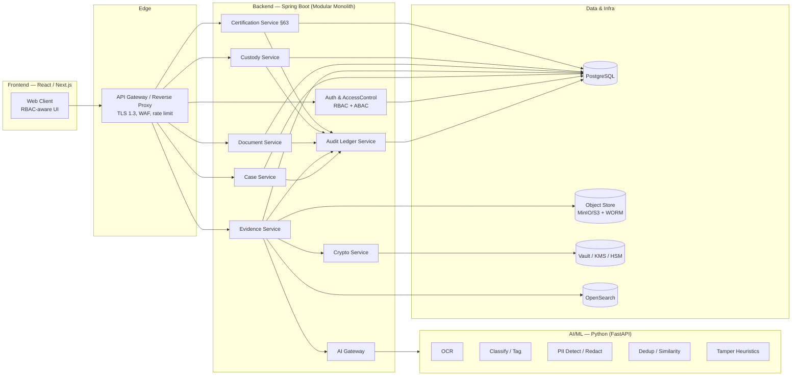
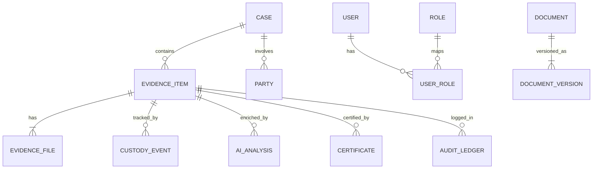

# SIH26190 — Secure Digital Evidence & Legal Document Management System

## Detailed Technical Implementation Plan

> **How this document was produced.** The environment that extracts full PDF body text was unavailable in this session, so this plan was reconstructed from the complete **section outline and technology stack** embedded in `SIH26190.pdf` plus domain knowledge of the problem space. The architecture, section structure, and stack (Spring Boot backend, React/Next.js frontend, Python AI/ML microservice, RBAC+ABAC, cryptographic/storage subsystem, append-only audit ledger, BSA §63 certification) are taken directly from your PDF. Anything not explicitly stated in the outline is a **recommended default** and is flagged in the *Assumptions to Confirm* section at the end — please reconcile these against the detailed prose in your PDF before building.

---

## 1. Problem Definition & Operational Context

The system is a chain-of-custody-grade platform for **collecting, storing, analysing, and certifying digital evidence and legal documents** so that they remain tamper-evident, access-controlled, and admissible in court under Indian law (Bharatiya Sakshya Adhiniyam, 2023 — **§63**, the successor to §65B of the Indian Evidence Act).

Core operational requirements the implementation must satisfy:

- **Integrity** — any evidence item must be provably unaltered from the moment of ingest (cryptographic hashing + digital signatures).
- **Chain of custody** — every touch (view, download, transfer, analysis, export) is recorded immutably with actor, time, and reason.
- **Access control** — need-to-know enforcement across roles (investigating officer, forensic analyst, prosecutor, court, auditor) and case-scoped attributes.
- **Admissibility** — one-click generation of a statutory §63 certificate that binds the record, its hashes, the production method, and the custody trail.
- **Auditability** — a tamper-evident, append-only ledger that can be independently verified.

---

## 2. Proposed Solution — Architectural Overview

A **modular monolith** (single Spring Boot application with strict internal module boundaries) for the core platform, paired with a **separate lightweight Python AI/ML microservice** and supporting infrastructure (relational DB, object store, key manager, search). This gives hackathon-speed delivery and operational simplicity now, while the module boundaries allow later extraction into independent services without rewrites.

### Step-by-Step Data Flow (ingest → certification)

1. **Capture/Upload** — An authorised officer uploads an evidence file through the Next.js client. The browser computes a **SHA-256 hash client-side (WebCrypto)** before/while uploading, for early integrity confirmation and UX.
2. **Transfer** — File is streamed to the backend via a **pre-signed upload** to object storage (or chunked/resumable upload for large device dumps).
3. **Server-side integrity** — Backend independently recomputes the hash, compares to the client hash, and rejects on mismatch.
4. **Seal** — Backend signs `hash + metadata` with the system signing key, writes an encrypted copy to WORM object storage, and creates the `evidence_item` + `evidence_file` records.
5. **Custody + ledger** — An `INGEST` custody event and an append-only, hash-chained audit ledger entry are written atomically.
6. **AI enrichment (optional/async)** — Backend dispatches a job to the Python service (OCR, classification, PII detection, de-duplication, tamper heuristics). Results are stored as **annotations linked to** — never overwriting — the original.
7. **Analysis & review** — Analysts/prosecutors view evidence through the client; every view/download is logged.
8. **Certification** — On request, the system generates a **BSA §63 certificate (signed PDF)** auto-populated with description, hashes, device/process particulars, and a custody summary.
9. **Archive/Dispose** — Retention policy governs archival and, eventually, audited disposal.

---

## 3. System Architecture & High-Level Data Flow



### 3.1 Security & Access Control (RBAC + ABAC)

Two layers combined:

- **RBAC** decides *what a role may do* (coarse-grained: e.g. `EVIDENCE_UPLOAD`, `CERTIFICATE_ISSUE`).
- **ABAC** decides *whether this specific user may act on this specific resource right now* (fine-grained: is the user assigned to the case? does clearance meet the item's classification? is access within the permitted jurisdiction/time?).

**Roles (initial set):** `SYSTEM_ADMIN`, `INVESTIGATING_OFFICER`, `FORENSIC_ANALYST`, `PROSECUTOR`, `COURT` (judge/registry, read-only), `DEFENSE` (grant-scoped read-only), `AUDITOR` (read + ledger verify), `RECORDS_CUSTODIAN`.

**ABAC attribute inputs:** `subject` (department, clearance level, assignedCaseIds), `resource` (caseId, classification, jurisdiction, custodyState), `action`, `environment` (time, source IP/network, request purpose). Decisions run at the service layer (defense-in-depth) — the UI hides what a user cannot do, but the server is the source of truth.

**Implementation:** Spring Security (method-level `@PreAuthorize`) for RBAC gates + a dedicated **policy evaluator** for ABAC. Recommended: **Open Policy Agent (OPA)** with Rego policies queried by a `PolicyDecisionPoint`; a self-contained in-JVM evaluator is an acceptable fallback for the hackathon build. All *deny* and *break-glass* decisions are logged to the audit ledger.

### 3.2 Cryptographic & Storage Subsystem

- **Hashing:** SHA-256 (primary) computed on ingest; stored immutably alongside the item. Optional SHA-512/BLAKE3 as secondary.
- **Digital signatures:** On ingest, sign `SHA-256(content) || canonical(metadata)` with the system signing key (ECDSA P-256 or RSA-3072 via **BouncyCastle**). Custodian/analyst signatures supported for handoffs.
- **Encryption at rest:** Envelope encryption — a per-object **DEK** (AES-256-GCM) encrypts the blob; the DEK is wrapped by a **KEK** held in the key manager. No plaintext keys on disk.
- **Encryption in transit:** TLS 1.3 at the edge; **mTLS** between backend and the Python service.
- **Key management:** HashiCorp **Vault** (Transit engine) for dev/hackathon; cloud KMS or an HSM (FIPS 140-2/3) for production. Enforced key rotation.
- **WORM storage:** MinIO/S3 **Object Lock** (compliance/retention mode) so evidence blobs cannot be modified or deleted during the retention window.
- **Trusted timestamping (recommended):** RFC 3161 timestamp on the ingest hash and on issued certificates to independently anchor the "as-of" time.

### 3.3 Append-Only Audit Ledger & Chain of Custody

- **Every** state-changing or access action writes a ledger entry: `{ seq, timestamp, actorId, action, resourceRef, details, prevHash, entryHash }` where `entryHash = SHA-256(seq || timestamp || actor || action || resourceRef || details || prevHash)`. This forms a **hash chain** — altering any past entry breaks every subsequent hash.
- **Chain of custody** is a specialised, human-meaningful projection over these entries: seizure, ingest, transfers (`from → to`, reason, signature), analyses, exports, certification, disposal.
- **Tamper resistance in the DB:** the ledger table is append-only, enforced by DB triggers/roles that reject `UPDATE`/`DELETE`; combined with WORM backups.
- **Verification:** a `GET /ledger/verify` endpoint recomputes the chain and reports the first broken link (if any). *(Optional strengthening: periodically anchor the ledger root hash to an external notary/public blockchain — mention as a stretch goal.)*

### 3.4 Statutory Evidence Certification (BSA §63)

Under the **Bharatiya Sakshya Adhiniyam, 2023, §63** (in force 1 July 2024; successor to Evidence Act §65B), electronic records require an accompanying certificate to be admissible. The system auto-generates this certificate as a **digitally signed PDF**, populated from data it already holds:

- Description/identification of the electronic record and the case it belongs to.
- The device/system that produced or stored it, and hardware/software particulars.
- The **manner of production** and that it was produced by a device in regular use.
- Cryptographic **hash values** and signature details establishing integrity.
- A **chain-of-custody summary** drawn from the ledger.
- Declarations and signature blocks (system digital signature + placeholders for the responsible person's and expert's signatures / DSC, per the §63 schedule's Part A / Part B structure).

> ⚠️ **Legal caveat (not legal advice).** The exact certificate format, wording, and Part A/Part B fields under §63 and its rules should be verified against the current official schedule and, ideally, reviewed by legal counsel before courtroom use. Treat the generated PDF as a compliant *template*, not a legal guarantee.

---

## 4. Backend Architecture Plan (Spring Boot Ecosystem)

### 4.1 Stack & key dependencies

- **Java 21 LTS**, **Spring Boot 3.3+**, Gradle (or Maven).
- **Spring Web** (REST), **Spring Data JPA**, **Spring Security** + **OAuth2 Resource Server**, **Spring Validation**.
- **PostgreSQL** driver; **Flyway** for versioned schema migrations.
- **MapStruct** (DTO mapping), **Lombok**.
- **springdoc-openapi** (auto Swagger UI / OpenAPI 3 spec).
- **BouncyCastle** (crypto), **AWS SDK v2 / MinIO SDK** (object storage), **Vault** Spring integration.
- **Resilience4j** (retry/circuit-breaker for AI calls), **Micrometer + Prometheus** (metrics), **OpenTelemetry** (tracing).
- **Testcontainers**, **JUnit 5**, **Mockito**, **Spring Cloud Contract** (contract tests with the ML service).

### 4.2 Module boundaries (packages)

Base package (placeholder): `gov.sih26190.evault`

```
gov.sih26190.evault
├── security        # authn (OIDC/JWT), RBAC gates, ABAC PolicyDecisionPoint
├── case            # cases, parties, case-team assignments
├── evidence        # ingest, lifecycle, metadata, retrieval
├── document        # legal document management + versioning
├── custody         # chain-of-custody events & transfers
├── crypto          # hashing, signing, verification, envelope encryption
├── storage         # object-store abstraction (WORM, presigned URLs)
├── ledger          # append-only hash-chained audit ledger + verifier
├── certification   # BSA §63 certificate generation (PDF + signing)
├── ai              # AI gateway client + job orchestration
├── search          # indexing/query facade (OpenSearch)
├── notification    # alerts (deadlines, access requests, tamper alarms)
└── common          # DTOs, error model, auditing aspects, config
```

Each module exposes a service interface to others; cross-module access to another module's JPA entities is forbidden (enforced by architecture tests, e.g. ArchUnit).

### 4.3 Representative REST API contract

All endpoints are versioned under `/api/v1`, require a Bearer JWT, and are authorised by RBAC + ABAC. Errors use RFC 7807 `application/problem+json`.

| Method | Path | Purpose | Min. role |
|---|---|---|---|
| `POST` | `/auth/token` | Exchange OIDC code / refresh for access token | — |
| `POST` | `/cases` | Create a case | INVESTIGATING_OFFICER |
| `GET` | `/cases/{id}` | Case detail + linked evidence | case member |
| `POST` | `/evidence/upload-url` | Get a pre-signed upload URL + client hash challenge | INVESTIGATING_OFFICER |
| `POST` | `/evidence` | Register uploaded object; server re-hashes, signs, seals | INVESTIGATING_OFFICER |
| `GET` | `/evidence/{id}` | Metadata + integrity status + AI annotations | case member |
| `GET` | `/evidence/{id}/content` | Time-limited download URL (logged) | case member |
| `POST` | `/evidence/{id}/custody-transfer` | Record a custody handoff (signed) | current custodian |
| `GET` | `/evidence/{id}/custody` | Full chain-of-custody timeline | case member / AUDITOR |
| `POST` | `/evidence/{id}/analyze` | Dispatch AI job(s) | FORENSIC_ANALYST |
| `POST` | `/certificates/{evidenceId}` | Generate BSA §63 certificate (PDF) | PROSECUTOR / CUSTODIAN |
| `GET` | `/ledger/verify` | Recompute + verify hash chain | AUDITOR |
| `GET` | `/documents` / `POST` `/documents` | Legal document list / upload (versioned) | role-scoped |

**Sample — register ingested evidence:**

```http
POST /api/v1/evidence
Authorization: Bearer <jwt>
Content-Type: application/json

{
  "caseId": "C-2026-000142",
  "objectKey": "uploads/tmp/8f3a...bin",
  "clientSha256": "9f86d0818...",
  "fileName": "seizure_phone_dump.zip",
  "classification": "RESTRICTED",
  "source": { "deviceMake": "Samsung", "deviceModel": "SM-A546", "seizedAt": "2026-09-08T14:20:00+05:30" }
}
```

```json
// 201 Created
{
  "evidenceId": "E-2026-004411",
  "serverSha256": "9f86d0818...",
  "integrity": "VERIFIED",
  "signatureId": "sig_01J...",
  "custodyState": "INGESTED",
  "ledgerSeq": 90231
}
```

### 4.4 Cross-cutting backend concerns

- **Atomicity:** evidence write + custody event + ledger entry occur in one transaction; the ledger append is the commit gate.
- **Idempotency:** ingest and certificate endpoints accept an `Idempotency-Key` to survive retries.
- **Async AI:** the AI gateway enqueues jobs (in-DB queue or lightweight broker) and updates annotation records on completion; Resilience4j guards the outbound calls.

---

## 5. Frontend Architecture Plan (React / Next.js)

### 5.1 Stack

- **Next.js (App Router) + TypeScript**, **React 18**.
- **TanStack Query** (server-state/caching) + **Zustand** (light UI state).
- **React Hook Form + Zod** (typed forms & validation).
- **Tailwind CSS + shadcn/ui** (accessible component primitives) — or MUI if preferred.
- **WebCrypto API** for client-side SHA-256 hashing during upload.
- Resumable/chunked uploads via **tus** or **presigned multipart** for large device dumps.
- **NextAuth** or a direct OIDC/PKCE flow to the identity provider; access tokens kept in memory, refresh via secure httpOnly cookie.

### 5.2 Core Frontend Modules (pages)

- **Dashboard** — my cases, pending access requests, deadlines, tamper alarms.
- **Case Workspace** — case metadata, parties, linked evidence, team.
- **Evidence Intake** — upload with live client-side hashing + integrity confirmation.
- **Evidence Viewer** — preview (image/video/doc/text) with a prominent **integrity badge** (VERIFIED / FAILED) and AI annotations (OCR text, tags, detected PII).
- **Chain-of-Custody Timeline** — chronological, signed custody events.
- **Audit Ledger Explorer** — searchable ledger with a one-click **"Verify chain"** action.
- **Certification** — generate, preview, and download the BSA §63 certificate PDF.
- **Document Management** — versioned legal documents with diff/history.
- **Admin** — users, role assignment, ABAC policies, retention rules.
- **Reports** — case/evidence/audit exports.

### 5.3 Responsibilities & Boundaries

- The client is **RBAC-aware for UX only** — it hides/disables actions the user can't perform, but **never enforces** authorization; the backend is authoritative on every request.
- Client-side hashing is a **convenience + early-integrity** check; the server independently recomputes and is the source of truth.
- No evidence bytes are cached persistently in the browser; downloads use short-lived signed URLs and are always logged.
- All privileged actions surface a confirmation + reason capture (fed into the ledger).

---

## 6. AI/ML Subsystem Plan (Lightweight Python Microservice)

### 6.1 Stack & framework

- **Python 3.12**, **FastAPI + Uvicorn**, **Pydantic** models.
- CPU-friendly, containerised, stateless; horizontally scalable.

### 6.2 Capabilities

- **OCR** — Tesseract or PaddleOCR to extract text from scanned docs/images.
- **Classification & auto-tagging** — document/evidence type classification (lightweight transformer or classical TF-IDF + linear model).
- **PII / NER detection & redaction** — spaCy + rule/regex for Aadhaar, phone, PAN, etc., producing redaction suggestions.
- **De-duplication / similarity** — perceptual hashing (pHash) for images/video frames, MinHash/SimHash for documents.
- **Tamper / manipulation heuristics** — Error-Level-Analysis and metadata consistency checks for images (flag for expert review; presented as *indicative, not conclusive*).
- **Semantic search embeddings (optional)** — sentence-transformers to power similarity search in OpenSearch.

### 6.3 Backend ↔ ML contract

Synchronous for fast ops, job-based for heavy ones. mTLS + service token.

```http
POST /ml/v1/analyze
Content-Type: application/json

{ "jobId": "J-771", "evidenceId": "E-2026-004411",
  "objectUrl": "https://minio/.../signed",
  "tasks": ["ocr", "classify", "pii", "dedup"] }
```

```json
// 200 OK (or async: 202 + callback to /api/v1/ai/callback)
{ "jobId": "J-771",
  "results": {
    "ocr": { "text": "...", "confidence": 0.94 },
    "classify": { "label": "financial_document", "score": 0.88 },
    "pii": [ { "type": "AADHAAR", "span": [102,114], "action": "redact" } ],
    "dedup": { "phash": "e1b0...", "matches": ["E-2026-003300"] }
  } }
```

### 6.4 Evidence-integrity rules for ML

- The ML service **operates only on copies/derived data** and **never mutates originals**.
- Every ML run is recorded as a ledger + custody event (`ANALYZED`, with model name + version) so results are themselves auditable.
- Outputs are stored as **annotations linked to** the evidence, clearly separated from the sealed original.

---

## 7. Core Data Models (Conceptual Reference)

**Primary store:** PostgreSQL (relational core + hash-chained ledger). **Blobs:** MinIO/S3 (WORM). **Search:** OpenSearch (derived index only).



Representative schemas for the integrity-critical tables:

```sql
CREATE TABLE evidence_item (
  id              UUID PRIMARY KEY,
  case_id         UUID NOT NULL REFERENCES "case"(id),
  file_name       TEXT NOT NULL,
  classification  TEXT NOT NULL,            -- PUBLIC/RESTRICTED/SECRET
  custody_state   TEXT NOT NULL,            -- SEIZED/INGESTED/UNDER_ANALYSIS/CERTIFIED/ARCHIVED/DISPOSED
  source_meta     JSONB,                    -- device make/model, seizedAt, officer
  created_by      UUID NOT NULL,
  created_at      TIMESTAMPTZ NOT NULL DEFAULT now()
);

CREATE TABLE evidence_file (
  id              UUID PRIMARY KEY,
  evidence_id     UUID NOT NULL REFERENCES evidence_item(id),
  object_key      TEXT NOT NULL,            -- WORM object-store key
  size_bytes      BIGINT NOT NULL,
  sha256          CHAR(64) NOT NULL,
  sha512          CHAR(128),
  signature       BYTEA NOT NULL,           -- signed hash+metadata
  signing_key_id  TEXT NOT NULL,
  dek_wrapped     BYTEA NOT NULL,           -- envelope-encrypted data key
  created_at      TIMESTAMPTZ NOT NULL DEFAULT now()
);

CREATE TABLE custody_event (
  id            UUID PRIMARY KEY,
  evidence_id   UUID NOT NULL REFERENCES evidence_item(id),
  event_type    TEXT NOT NULL,              -- INGEST/TRANSFER/VIEW/DOWNLOAD/ANALYZE/EXPORT/CERTIFY/DISPOSE
  actor_id      UUID NOT NULL,
  from_party    UUID, to_party UUID,
  reason        TEXT,
  actor_signature BYTEA,
  occurred_at   TIMESTAMPTZ NOT NULL DEFAULT now()
);

-- Append-only, tamper-evident hash chain
CREATE TABLE audit_ledger (
  seq          BIGSERIAL PRIMARY KEY,
  occurred_at  TIMESTAMPTZ NOT NULL DEFAULT now(),
  actor_id     UUID,
  action       TEXT NOT NULL,
  resource_ref TEXT NOT NULL,
  details      JSONB,
  prev_hash    CHAR(64) NOT NULL,
  entry_hash   CHAR(64) NOT NULL          -- SHA-256 over row + prev_hash
);
-- Triggers reject UPDATE/DELETE on audit_ledger (enforced at DB role level).

CREATE TABLE certificate (
  id            UUID PRIMARY KEY,
  evidence_id   UUID NOT NULL REFERENCES evidence_item(id),
  standard      TEXT NOT NULL DEFAULT 'BSA_2023_S63',
  pdf_object_key TEXT NOT NULL,
  hash_snapshot CHAR(64) NOT NULL,
  issued_by     UUID NOT NULL,
  issued_at     TIMESTAMPTZ NOT NULL DEFAULT now(),
  signature     BYTEA NOT NULL
);
```

Other tables: `user`, `role`, `permission`, `user_role`, `abac_policy`, `case`, `party`, `document`, `document_version`, `ai_analysis`, `access_request`, `disposal_record`.

---

## 8. Cross-Cutting: DevOps, Infrastructure & Deployment

- **Containers:** Docker for backend, frontend, and ML service; `docker-compose` for local (adds PostgreSQL, MinIO, Vault, OpenSearch, Keycloak). Kubernetes/Helm optional for production.
- **CI/CD (GitHub Actions):** build → unit/integration tests (Testcontainers) → SAST + dependency scan (e.g. CodeQL, OWASP Dependency-Check) → container build/scan (Trivy) → deploy to staging.
- **Config & secrets:** externalised config; secrets from Vault/KMS, never committed.
- **Observability:** structured JSON logs → centralised store; Prometheus + Grafana dashboards; OpenTelemetry traces across backend ↔ ML.
- **Backup & DR:** automated PostgreSQL backups (PITR) + object-store replication; documented restore runbook; ledger integrity re-verified post-restore.
- **Hardening:** TLS 1.3 + mTLS, WAF/rate limiting at the edge, least-privilege DB roles, network segmentation for the data tier.

---

## 9. Testing & Quality Strategy

- **Unit** — JUnit 5 + Mockito (backend), pytest (ML), Vitest/RTL (frontend).
- **Integration** — Testcontainers (Postgres, MinIO); contract tests (Spring Cloud Contract) between backend and ML.
- **Security-critical tests** — hash/signature round-trips, ledger tamper-detection (mutate a row → verifier must flag it), envelope encryption/decryption, WORM immutability, ABAC deny paths.
- **E2E** — Playwright covering the full ingest → analyse → certify → verify flow.
- **Non-functional** — k6 load tests on ingest/download; large-file upload resilience.

---

## 10. Suggested Build Sequencing (concise)

Kept intentionally light since this document is a technical spec, not a timeline.

1. **Foundation** — auth (OIDC/JWT), user/role model, case + evidence CRUD, PostgreSQL + object store wiring.
2. **Integrity core** — server-side hashing, signing, envelope encryption, custody events, **append-only ledger + verifier** *(the differentiating demo)*.
3. **Certification** — BSA §63 PDF generation + signing.
4. **Frontend** — intake, evidence viewer with integrity badge, custody timeline, ledger explorer, certificate download.
5. **AI microservice** — OCR + classification + PII first; dedup/tamper heuristics next.
6. **Hardening & polish** — RBAC/ABAC edge cases, observability, tests, demo data.

---

## 11. Curated Standards & Documentation References

Verify and cite these where relevant (especially for the pitch and for admissibility claims):

- **Bharatiya Sakshya Adhiniyam, 2023 — §63** (electronic-record certificate; successor to Evidence Act §65B).
- **Information Technology Act, 2000** (digital signatures, electronic records) and **CERT-In** guidelines.
- **ISO/IEC 27037** — identification, collection, acquisition & preservation of digital evidence.
- **NIST SP 800-86** — guide to integrating forensic techniques into incident response.
- **ISO/IEC 27001 / 27002** — information security management.
- **SWGDE** best practices for digital evidence.
- **OWASP ASVS** — application security verification; **OWASP Top 10**.
- **FIPS 140-2/3** — cryptographic module validation (for KMS/HSM in production).
- **RFC 3161** — trusted timestamping.

---

## 12. Assumptions to Confirm Against the PDF

These were chosen as sensible defaults because full PDF prose could not be extracted — please reconcile each against your write-up:

- **Architecture style:** modular monolith + separate Python ML service (vs. full microservices).
- **Datastores:** PostgreSQL (core), MinIO/S3 (blobs, WORM), OpenSearch (search), Vault (keys). Your PDF may name specific products.
- **Identity provider:** Keycloak / OIDC assumed for auth.
- **Ledger design:** in-DB hash chain (with optional external anchoring) — confirm whether your PDF specifies a blockchain/DLT.
- **Role list & ABAC attributes:** the specific roles/attributes above are inferred; align them with your Problem Definition section.
- **AI scope:** OCR, classification, PII, dedup, tamper heuristics assumed — confirm which your PDF actually commits to.
- **BSA §63 certificate fields:** structure inferred; validate exact schedule/format with an official/legal source.

---

*Prepared for SIH26190. Reconstructed from the PDF's section outline and technology stack; confirm the assumptions above against the source document.*
